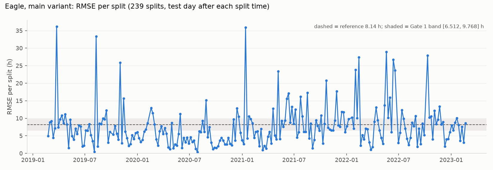
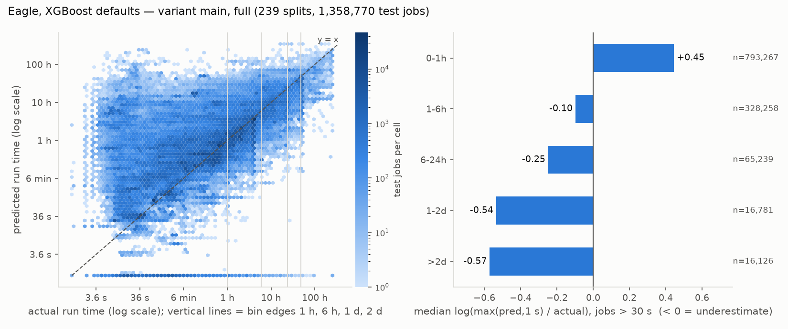

# Phase 1 report — Layer 1 baseline: reproduce Menear et al. on Eagle

<!-- PREREGISTRATION:BEGIN -->
## 0. Pre-committed decision rules (recorded before any full-run result was seen)

Given by Mahesh on 9 Oct 2026 after the fast-mode review; committed to git before the full
runs started. The report generator copies this section verbatim; it is never regenerated.

1. Gate 1 stays on **pooled RMSE (main variant)**, as agreed. The gate metric is not changed.
2. If pooled RMSE misses 6.512–9.768 h, Phase 1 is recorded as **"harness validated, exact
   reproduction not achieved"** if and only if:
   (a) the long-job rule passes (median r = log(max(ŷ,1)/y) in the > 2 d bin, jobs with
   y > 30 s, is negative and the lowest of the five bins);
   (b) the **median per-split RMSE** of the main run is inside 6.512–9.768 h;
   (c) the report lists the known setup gaps: xgboost 3.2.0 default tree method and estimated
   base_score vs 1.7.1; fixed feature set vs the paper's per-split search; unknown aggregation.
   In that case decision D16 is added to PLAN.md §16 and docs/decisions.md saying exactly this,
   dated 9 Oct 2026. Otherwise Gate 1 is recorded as FAIL.
3. Sensitivity runs (approved): `tree_method="approx"` and `base_score=0.5`, both on the main
   variant, full 244 splits. They are **SENSITIVITY ONLY** and cannot change the Gate 1 outcome.
4. The report also includes: per-split RMSE over time (one line plot); the 5 worst splits with
   their dates and the number of test jobs > 2 d in each; the per-bin table for all variants.
<!-- PREREGISTRATION:END -->

_Sections 1–9 generated by `scripts/make_phase1_report.py` from the run folders listed in §3.
Do not edit by hand; re-run the script._

## 1. Result

**Gate 1: PASS**

| condition | value | result |
|---|---|---|
| pooled RMSE (main, all 1,358,770 test jobs of 239 non-empty splits; 244 split times) in [6.512, 9.768] h | 7.380 h | pass |
| long-job rule: median r in > 2 d bin negative and lowest of the five bins | -0.570 (negative: yes, lowest: yes) | pass |
| rule 2(b): median per-split RMSE (main) in band | 6.437 h | outside |
| rule 2(c): known setup gaps listed | §2 | listed |

Reference: Menear et al. report RMSE 8.14 h for per-split feature selection (F6). The paper does
**not** say whether this is pooled over all test jobs or averaged over splits; this report gives
both (§4). Gate band = 8.14 h ± 20% = [6.512, 9.768] h (PLAN.md rounds it to 6.5–9.8 h).
Sensitivity runs (§6) are labelled SENSITIVITY ONLY and do not change this outcome.

## 2. Known setup gaps vs the paper (rule 2c)

1. **xgboost version**: 3.2.0 here vs 1.7.1 in the paper. Two defaults may differ:
   the default tree method (saved booster config of the main run records
   `tree_method = auto`; `sens_approx` records `approx`) and `base_score`, which 3.2.0 estimates from each training set
   (observed: per-split base_score ranges 5,263–28,294 s in the main run),
   while 1.7.1 is believed to use a fixed 0.5 (xgboost 2.0 release notes; not verified in this
   repo; checked by the `sens_base05` run).
2. **Feature set**: fixed (numerical walltime_req_s, procs_req, mem_req, nodes_req, gpus_req;
   categorical user, partition) per D6, vs the paper's per-split feature-set search
   (8.14 h is the per-split-selection result; 8.45 h with previous-split selection, F6).
3. **Aggregation**: unknown in the paper (pooled vs mean of splits).
4. Row filter: COMPLETED + TIMEOUT with non-null walltime (D5, addendum A). The paper states
   cancelled/failed dropped and timeouts kept; it does not mention OUT_OF_MEMORY, NODE_FAIL,
   PENDING, RUNNING or null walltime handling.

## 3. Runs and commands

```bash
uv run python -m hpcdiag.layer1.run_menear --config configs/phase1_menear.yaml --variant main   # 20261009-221851-main-full
uv run python -m hpcdiag.layer1.run_menear --config configs/phase1_menear.yaml --variant v1_rt30   # 20261009-222142-v1_rt30-full
uv run python -m hpcdiag.layer1.run_menear --config configs/phase1_menear.yaml --variant v2_nodup   # 20261009-222416-v2_nodup-full
uv run python -m hpcdiag.layer1.run_menear --config configs/phase1_menear.yaml --variant sens_approx   # 20261009-222703-sens_approx-full
uv run python -m hpcdiag.layer1.run_menear --config configs/phase1_menear.yaml --variant sens_base05   # 20261009-224856-sens_base05-full
uv run python scripts/make_phase1_report.py --runs main=20261009-221851-main-full v1_rt30=20261009-222142-v1_rt30-full v2_nodup=20261009-222416-v2_nodup-full sens_approx=20261009-222703-sens_approx-full sens_base05=20261009-224856-sens_base05-full
```

Fast mode (12 splits) was run first for main, v1_rt30, v2_nodup and reviewed before the full runs.

Provenance note: runs v1_rt30, v2_nodup, sens_approx, sens_base05 recorded a `-dirty` commit. While they ran, the only uncommitted changes were `src/hpcdiag/eval/plots.py` (a new function `rmse_over_time` appended; not called by the runner), the untracked `scripts/make_phase1_report.py`, and an addendum to `reports/phase_0.md` — none on the training/prediction path. These were committed right after the runs. The gated main run is on a clean commit.

| variant | run id | git commit | rows after filter | splits | test jobs | seconds (fit+predict total) |
|---|---|---|---|---|---|---|
| main | `20261009-221851-main-full` | `37fc1bc59b` | 8,193,494 | 239 | 1,358,770 | 166 |
| v1_rt30 | `20261009-222142-v1_rt30-full` | `37fc1bc59b` | 7,340,664 | 239 | 1,219,671 | 149 |
| v2_nodup | `20261009-222416-v2_nodup-full` | `37fc1bc59b` | 8,110,441 | 239 | 1,337,019 | 161 |
| sens_approx | `20261009-222703-sens_approx-full` | `37fc1bc59b` | 8,193,494 | 239 | 1,358,770 | 1308 |
| sens_base05 | `20261009-224856-sens_base05-full` | `37fc1bc59b` | 8,193,494 | 239 | 1,358,770 | 516 |

- xgboost 3.2.0; model params: main `defaults`; full booster config in each run's `xgb_config.json` (identical across splits apart from base_score).
- Splits: 244 in the full list, first 2019-02-22 13:27:04, last 2023-02-19 13:27:04; all variants use the same split times (from the main-filtered rows).
- Splits used: 239 of 244. 5 split(s) were skipped because the train or test window was empty (main filter):

| skipped split time | training jobs | test jobs |
|---|---|---|
| 2019-10-02 13:27:04 | 481,496 | 0 |
| 2020-02-11 13:27:04 | 597,336 | 0 |
| 2022-01-13 13:27:04 | 312,799 | 0 |
| 2022-06-24 13:27:04 | 601,375 | 0 |
| 2022-10-04 13:27:04 | 538,073 | 0 |

  A skipped split contributes no test jobs, so pooled metrics are unaffected; mean/median of
  per-split RMSE are over the 239 non-empty splits. Whether the paper's 244 splits include
  empty test days is unknown.
- Leakage check: max(train end_time − split time) over splits = -1 s (must be < 0).
- Tests: `53 passed in 2.52s`; lint: `All checks passed!`.

## 4. Overall metrics

RMSE/MAE use unclipped predictions on all test jobs. TARE A_geo / UnderRate use predictions
clipped to ≥ 1 s on test jobs with run_time > 30 s (addendum D).

| variant | RMSE pooled (h) | RMSE mean of splits (h) | RMSE median of splits (h) | MAE pooled (h) | MAE mean of splits (h) | A_geo | UnderRate | predictions < 1 s (of which < 0) |
|---|---|---|---|---|---|---|---|---|
| main | 7.380 | 7.636 | 6.437 | 2.079 | 2.991 | 0.5087 | 0.4091 | 37,777 (37,774) |
| v1_rt30 | 7.474 | 7.772 | 6.342 | 2.121 | 3.141 | 0.4908 | 0.3966 | 25,758 (25,750) |
| v2_nodup | 7.234 | 7.596 | 6.349 | 2.023 | 3.000 | 0.5016 | 0.4092 | 48,041 (47,879) |
| sens_approx | 7.380 | 7.636 | 6.437 | 2.079 | 2.991 | 0.5087 | 0.4091 | 37,777 (37,774) |
| sens_base05 | 7.416 | 7.645 | 6.386 | 2.079 | 3.001 | 0.5134 | 0.4134 | 31,911 (31,699) |

- main: COMPLETED+TIMEOUT, walltime present; XGBoost defaults
- v1_rt30: main + run_time_s > 30
- v2_nodup: main − exact duplicate rows (D10)
- sens_approx: SENSITIVITY ONLY: main, tree_method=approx
- sens_base05: SENSITIVITY ONLY: main, base_score=0.5

## 5. Error by actual-runtime bin (all variants)

`median r` = median of log(max(ŷ,1 s)/y) and `UnderRate` = share with ŷ < y, both on jobs with
y > 30 s (`n_r`). RMSE, MAE and mean signed error (ŷ − y, hours; context only, not the gate)
use all jobs in the bin.

**main**

| bin | n | RMSE (h) | MAE (h) | mean signed error (h) | mean actual (h) | mean predicted (h) | n_r | median r | UnderRate |
|---|---|---|---|---|---|---|---|---|---|
| 0-1h | 932,366 | 4.395 | 1.140 | +1.067 | 0.217 | 1.284 | 793,267 | +0.445 | 0.272 |
| 1-6h | 328,258 | 4.603 | 1.670 | +0.479 | 2.641 | 3.119 | 328,258 | -0.098 | 0.639 |
| 6-24h | 65,239 | 11.217 | 6.998 | -0.832 | 11.939 | 11.107 | 65,239 | -0.248 | 0.662 |
| 1-2d | 16,781 | 21.268 | 15.768 | -10.377 | 32.154 | 21.777 | 16,781 | -0.535 | 0.869 |
| >2d | 16,126 | 45.398 | 30.529 | -29.276 | 63.114 | 33.838 | 16,126 | -0.570 | 0.966 |

Long-job rule: median r (> 2 d) = -0.570; pass.

**v1_rt30**

| bin | n | RMSE (h) | MAE (h) | mean signed error (h) | mean actual (h) | mean predicted (h) | n_r | median r | UnderRate |
|---|---|---|---|---|---|---|---|---|---|
| 0-1h | 793,267 | 4.180 | 1.052 | +0.968 | 0.254 | 1.223 | 793,267 | +0.487 | 0.257 |
| 1-6h | 328,258 | 4.854 | 1.735 | +0.634 | 2.641 | 3.274 | 328,258 | -0.072 | 0.634 |
| 6-24h | 65,239 | 11.168 | 6.919 | -0.423 | 11.939 | 11.517 | 65,239 | -0.205 | 0.640 |
| 1-2d | 16,781 | 20.220 | 15.266 | -9.805 | 32.154 | 22.349 | 16,781 | -0.510 | 0.855 |
| >2d | 16,126 | 44.228 | 29.444 | -28.011 | 63.114 | 35.103 | 16,126 | -0.534 | 0.952 |

Long-job rule: median r (> 2 d) = -0.534; pass.

**v2_nodup**

| bin | n | RMSE (h) | MAE (h) | mean signed error (h) | mean actual (h) | mean predicted (h) | n_r | median r | UnderRate |
|---|---|---|---|---|---|---|---|---|---|
| 0-1h | 912,734 | 4.213 | 1.056 | +0.979 | 0.218 | 1.198 | 776,002 | +0.395 | 0.272 |
| 1-6h | 326,618 | 4.634 | 1.710 | +0.554 | 2.641 | 3.195 | 326,618 | -0.075 | 0.634 |
| 6-24h | 64,989 | 10.801 | 6.770 | -0.839 | 11.950 | 11.111 | 64,989 | -0.262 | 0.664 |
| 1-2d | 16,619 | 20.306 | 15.544 | -10.312 | 32.217 | 21.905 | 16,619 | -0.516 | 0.858 |
| >2d | 16,059 | 44.861 | 30.128 | -28.949 | 63.140 | 34.191 | 16,059 | -0.577 | 0.964 |

Long-job rule: median r (> 2 d) = -0.577; pass.

**sens_approx** — SENSITIVITY ONLY

| bin | n | RMSE (h) | MAE (h) | mean signed error (h) | mean actual (h) | mean predicted (h) | n_r | median r | UnderRate |
|---|---|---|---|---|---|---|---|---|---|
| 0-1h | 932,366 | 4.395 | 1.140 | +1.067 | 0.217 | 1.284 | 793,267 | +0.445 | 0.272 |
| 1-6h | 328,258 | 4.603 | 1.670 | +0.479 | 2.641 | 3.119 | 328,258 | -0.098 | 0.639 |
| 6-24h | 65,239 | 11.217 | 6.998 | -0.832 | 11.939 | 11.107 | 65,239 | -0.248 | 0.662 |
| 1-2d | 16,781 | 21.268 | 15.768 | -10.377 | 32.154 | 21.777 | 16,781 | -0.535 | 0.869 |
| >2d | 16,126 | 45.398 | 30.529 | -29.276 | 63.114 | 33.838 | 16,126 | -0.570 | 0.966 |

Long-job rule: median r (> 2 d) = -0.570; pass.

**sens_base05** — SENSITIVITY ONLY

| bin | n | RMSE (h) | MAE (h) | mean signed error (h) | mean actual (h) | mean predicted (h) | n_r | median r | UnderRate |
|---|---|---|---|---|---|---|---|---|---|
| 0-1h | 932,366 | 4.336 | 1.133 | +1.061 | 0.217 | 1.278 | 793,267 | +0.454 | 0.279 |
| 1-6h | 328,258 | 4.667 | 1.697 | +0.514 | 2.641 | 3.154 | 328,258 | -0.095 | 0.637 |
| 6-24h | 65,239 | 11.013 | 6.876 | -0.964 | 11.939 | 10.975 | 65,239 | -0.284 | 0.672 |
| 1-2d | 16,781 | 24.457 | 16.762 | -9.039 | 32.154 | 23.114 | 16,781 | -0.516 | 0.867 |
| >2d | 16,126 | 44.624 | 29.912 | -28.627 | 63.114 | 34.487 | 16,126 | -0.575 | 0.968 |

Long-job rule: median r (> 2 d) = -0.575; pass.

## 6. Sensitivity runs (SENSITIVITY ONLY — cannot change Gate 1)

| run | pooled RMSE (h) | Δ vs main (h) | median per-split RMSE (h) | long-job rule |
|---|---|---|---|---|
| main | 7.380 | +0.000 | 6.437 | pass |
| sens_approx | 7.380 | +0.000 | 6.437 | pass |
| sens_base05 | 7.416 | +0.037 | 6.386 | pass |

| run | tree_method in saved config | fit+predict seconds (all splits) | max abs prediction difference vs main (s) | predictions identical to main |
|---|---|---|---|---|
| main | `auto` | 166 | 0.0 | yes |
| sens_approx | `approx` | 1308 | 0.0 | yes |
| sens_base05 | `auto` | 516 | 271,120.9 | no |

## 7. Per-split RMSE over time (main)



Per-split RMSE (main): min 0.329 h, median 6.437 h, mean 7.636 h,
max 36.165 h; 66 of 239 splits inside the band,
52 above, 121 below.

**5 worst splits (main)**

| split time | RMSE (h) | test jobs | test jobs with actual run time ≥ 2 d | share of all squared error (pooled) |
|---|---|---|---|---|
| 2019-03-24 13:27:04 | 36.165 | 459 | 55 | 0.008 |
| 2021-01-12 13:27:04 | 35.893 | 1,661 | 142 | 0.029 |
| 2019-08-09 13:27:04 | 33.397 | 1,210 | 171 | 0.018 |
| 2022-05-19 13:27:04 | 28.958 | 2,841 | 10 | 0.032 |
| 2022-10-10 13:27:04 | 27.949 | 4,523 | 575 | 0.048 |

Across all 239 splits the main run has 16,126 test jobs ≥ 2 d
(1.19% of test jobs).

## 8. Predicted vs actual by bin (main)



Left: all main test jobs, log-log; predictions and actuals below 1 s (including negative
predictions) are drawn at 1 s, which is the flat row at the bottom. Right: median r per bin.

## 9. Other checks

- Test jobs with a user unseen in that split's training window (main): 3,507
  (0.26%); unseen partition: 366.
- Training rows per split (main): min 84,542, median 536,528, max 992,860.
- Test rows per split (main): min 2, median 4,016, max 38,614.
- Nothing was tuned on test splits. Gate 1 uses only the main variant.

## Addendum (9 Oct 2026, after Phase 1 acceptance — hand-written; sections above unchanged)

**sens_approx diagnostic.** `uv run python scripts/diag_xgb_tree_method.py` (split index 90,
2020-08-15 13:27:04; 656,543 training rows, 2,402 test rows; xgboost 3.2.0), fitted outside the
runner: default (`auto`), `hist` and `approx` gave identical dumped trees and bitwise-identical
predictions (max |difference| 0); `exact` differed (max 122,419 s), and `max_bin=64` differed
from the default (max 307,497 s) but was identical between `hist` and `approx`. Parameters
therefore reach the fitted model; the identity of `sens_approx` and main is xgboost 3.2.0
behaviour on this data, not a runner bug. The cause was not investigated further. A guard test
(`test_non_default_param_changes_predictions`) was added. The `sens_approx` result in §6
stands; no rerun needed.
