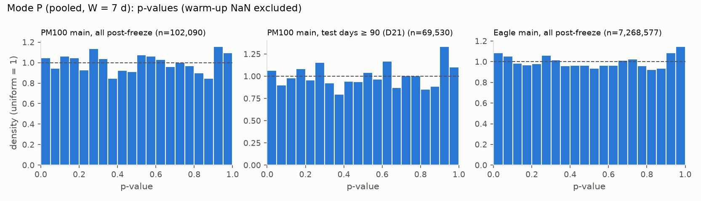
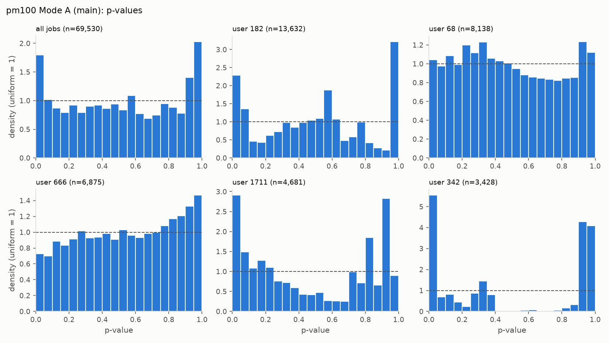
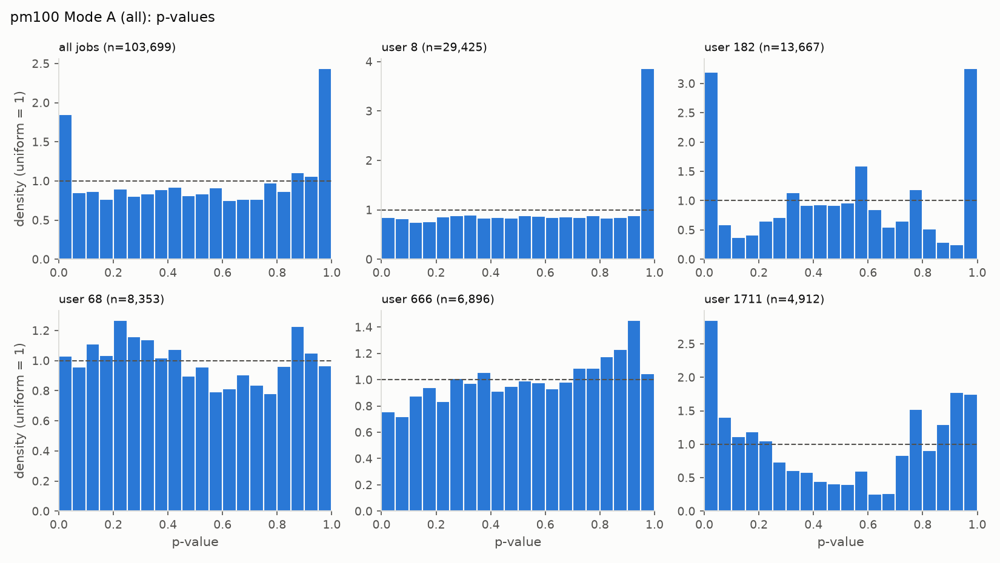
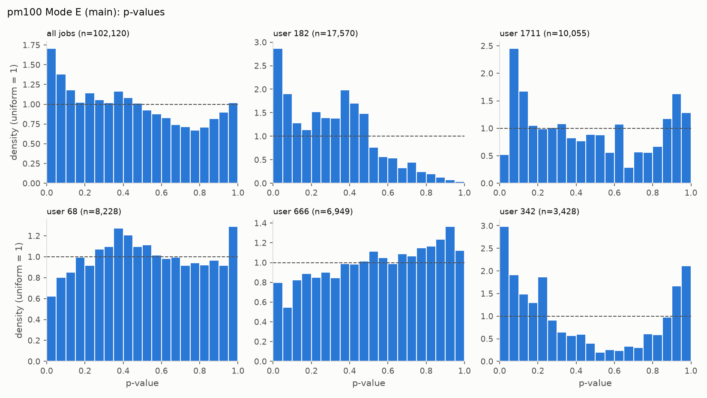
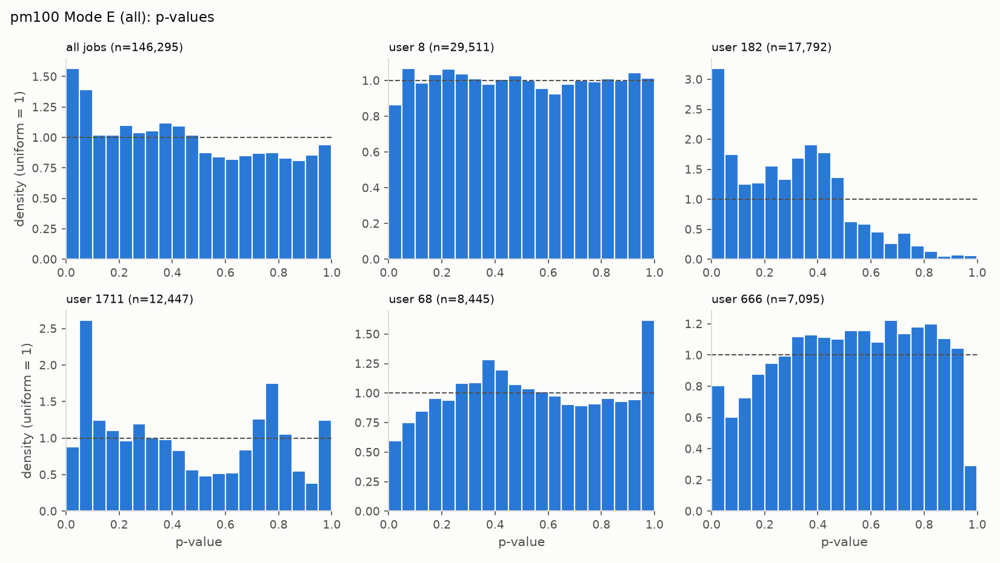
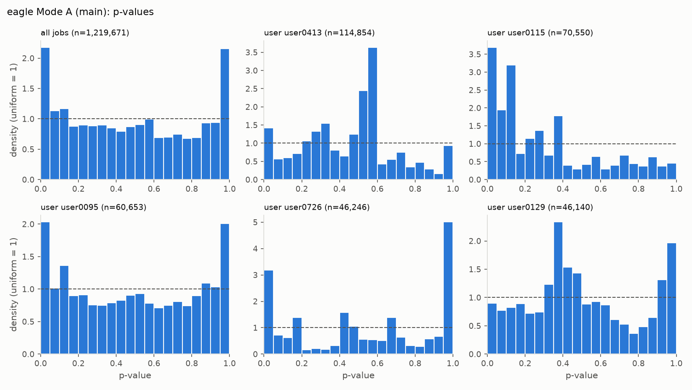
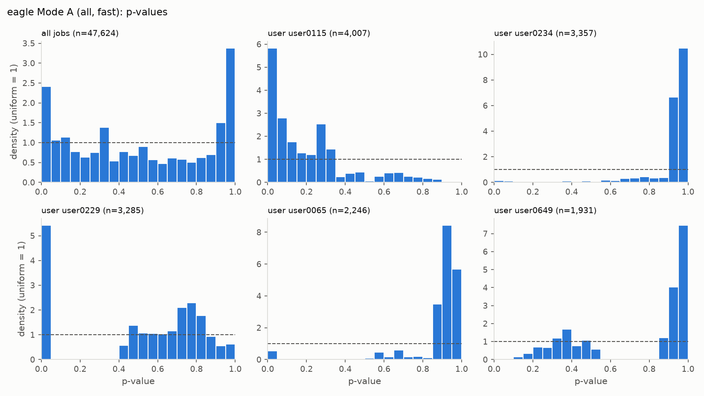
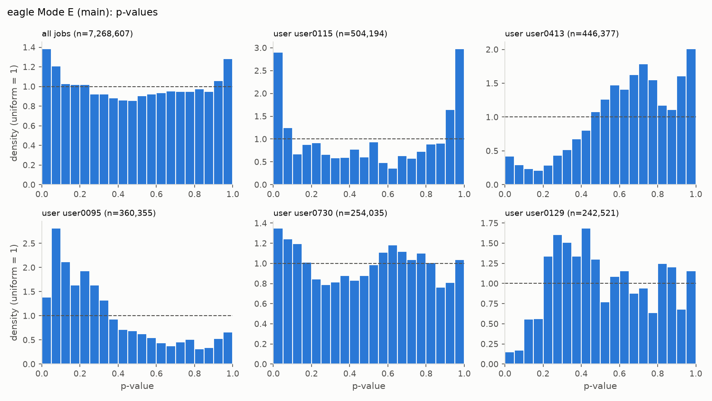
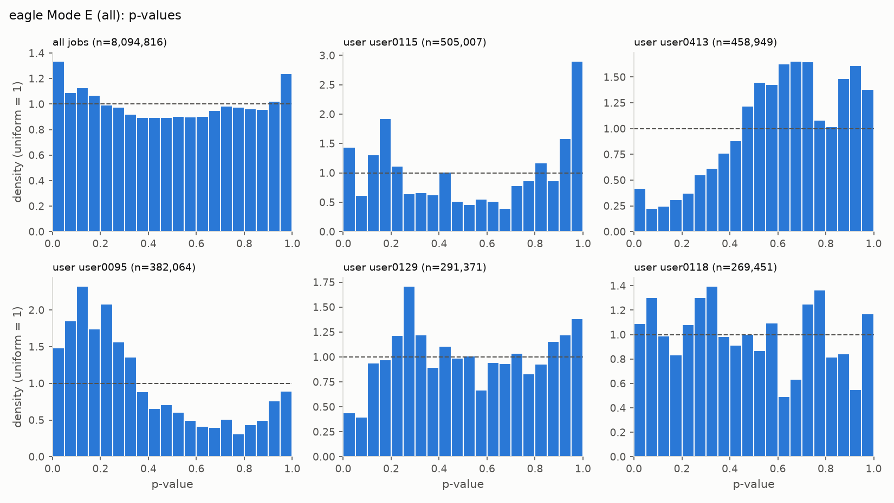

# Phase 2 report — Layer 1: quantile model, conformal p-values, ACI (PROMPT 2 + 2B)

_Generated by `scripts/make_phase2_report.py` from the run folders listed in §11. Do not edit by hand._

## 1. Result

| gate | dataset | p-values | result | numbers |
|---|---|---|---|---|
| Gate 2 (original, PLAN) | pm100 main | Mode E, user→partition→global fallback | **FAIL** | KS 0.0907 (≤ 0.02); FA 0.0229 at 0.01 / 0.0855 at 0.05 / 0.1545 at 0.1 (±0.01) |
| Gate 2 (original, PLAN) | eagle main | Mode E, user→partition→global fallback | **FAIL** | KS 0.0333 (≤ 0.02); FA 0.0158 at 0.01 / 0.0693 at 0.05 / 0.1297 at 0.1 (±0.01) |
| Gate 2 ACI part (D25: one global stream) | pm100 main | Mode A, γ = 0.005 | pass | rate 0.0502 (0.05 ± 0.005) |
| Gate 2 ACI part (D25: one global stream) | eagle main | Mode A, γ = 0.005 | pass | rate 0.0500 (0.05 ± 0.005) |
| **Gate 2-L2 (D26)** | PM100 main, all post-freeze jobs after warm-up | Mode P, pooled, W = 7 d | pass | KS 0.0131; FA 0.0125 / 0.0523 / 0.0997; P(p≤1e-3) 0.00124 (≤ 0.002); mean f 0.825 vs null p95 1.149; global ACI 0.0501 |
| **Gate 2-L2 (D26)** | PM100 main, test days ≥ 90 (D21) | Mode P, pooled, W = 7 d | **FAIL** | KS 0.0232; FA 0.0119 / 0.0534 / 0.0985; P(p≤1e-3) 0.00131 (≤ 0.002); mean f 0.831 vs null p95 1.135; global ACI 0.0501 |
| **Gate 2-L2 (D26)** | Eagle main (reported; does not feed Layer 2) | Mode P, pooled, W = 7 d | **FAIL** | KS 0.0116; FA 0.0120 / 0.0543 / 0.1070; P(p≤1e-3) 0.00156 (≤ 0.002); mean f 1.617 vs null p95 1.029; global ACI 0.0500 |

Gate 2-L2 is the gate for the input to Layer 2 (PM100, Mode P, W = 7 d); the original Gate 2 criteria are kept and reported (D26).

**PM100 Gate 2-L2: main set PASS; D21 subset (test days ≥ 90) FAIL (failing check(s): ks).** PROMPT 2B: if PM100 Mode P fails Gate 2-L2, STOP and report; do not try more windows. No further windows were tried. D21 was defined as a sensitivity check; whether a D21-subset failure counts as a Gate 2-L2 failure is a decision for Mahesh.

## 2. Corrections to how the fast results were read (PROMPT 2B Step 1)

- False-alarm rate by **actual** runtime bin and TIMEOUT share among alarms are conditioned on the
  outcome. A perfectly calibrated p-value also alarms more often on jobs that turned out long, and
  TIMEOUT jobs are by definition jobs that ran to their limit. Both tables are kept below and labelled
  **"descriptive, outcome-conditioned — not a calibration check"**.
- **Retracted:** my fast-run summary said "the censoring assumption in PLAN 2.2 says their p-values should
  be conservative, which would make them under-represented". PLAN 2.2 only says that a TIMEOUT job's own
  p-value is larger than its uncensored p-value would be; it says nothing about their share among alarms.
- **Added (valid conditional checks):** FA at α = 0.05 by decile of q̂ (model prediction) and by decile of
  walltime_req_s (known at submit), decile edges from the model's training rows (§7).

## 3. Verification of the architect's exploratory finding (Step 2)

Recomputed with this repo's code (`hpcdiag.layer1.post_scores`, run `20261010-001026-post-repro-fast`) on the fast Mode E
scores (PM100 `20261009-232632-pm100-E-main-fast`, Eagle `20261009-233039-eagle-E-main-fast`). θ for Mode P = the Mode E θ of the same
job (theta_seed 12345); the architect's θ seed differed.

| item | architect (as given) | this repo: n / KS / FA .01 / .05 / .10 / P(p≤1e-3) / P(p≤1e-4) / mean f |
|---|---|---|
| PM100 main, Mode P W = 7 d | n 102,090; KS 0.0132; FA .0125/.0523/.0997; P(p≤1e-3) 0.00126; mean f 0.814 (null 50th 0.80, 95th 1.155) | 102,090 / 0.0131 / 0.0125 / 0.0523 / 0.0997 / 0.00124 / 0.00010 / 0.825 (null p50 0.794, p95 1.149, p99 2.669) |
| Eagle main, Mode P W = 7 d | n 371,874; KS 0.0218; FA .0122/.0564/.1058; P(p≤1e-3) 0.0021; P(p≤1e-4) 0.00071; mean f 1.596 (null 95th 1.039, 99th 1.234) | 371,874 / 0.0217 / 0.0122 / 0.0564 / 0.1058 / 0.00207 / 0.00069 / 1.741 (null p50 0.813, p95 1.079, p99 1.473) |
| PM100 main, Mode E as run, same jobs | mean f 1.419; P(p≤1e-3) 0.00317 | 102,090 / 0.0908 / 0.0229 / 0.0855 / 0.1546 / 0.00317 / 0.00033 / 1.420 (null p50 0.794, p95 1.149, p99 2.669) |
| Eagle main, Mode E as run, same jobs | mean f 1.379; P(p≤1e-3) 0.00356 | 371,874 / 0.0408 / 0.0246 / 0.0674 / 0.1262 / 0.00356 / 0.00032 / 1.379 (null p50 0.813, p95 1.079, p99 1.473) |
| PM100 main, user-first W = 7 d (our definition†) | KS 0.052 (definition not given) | 102,090 / 0.0630 / 0.0298 / 0.0903 / 0.1498 / 0.00466 / 0.00055 / 1.537 (null p50 0.794, p95 1.149, p99 2.669) |

Monte-Carlo noise from θ (Mode P, W = 7 d, 5 extra θ seeds):

| dataset | seed | KS | FA .01 / .05 / .10 | P(p≤1e-3) | mean f |
|---|---|---|---|---|---|
| PM100 | 101 | 0.0132 | 0.0124 / 0.0523 / 0.0997 | 0.00125 | 0.839 |
| PM100 | 102 | 0.0131 | 0.0124 / 0.0523 / 0.0997 | 0.00128 | 0.836 |
| PM100 | 103 | 0.0132 | 0.0125 / 0.0524 / 0.0997 | 0.00126 | 0.866 |
| PM100 | 104 | 0.0132 | 0.0124 / 0.0523 / 0.0997 | 0.00127 | 0.847 |
| PM100 | 105 | 0.0132 | 0.0125 / 0.0524 / 0.0997 | 0.00126 | 0.844 |
| Eagle | 101 | 0.0217 | 0.0122 / 0.0564 / 0.1058 | 0.00208 | 2.666 |
| Eagle | 102 | 0.0218 | 0.0122 / 0.0564 / 0.1058 | 0.00209 | 1.860 |
| Eagle | 103 | 0.0217 | 0.0122 / 0.0564 / 0.1058 | 0.00207 | 1.688 |
| Eagle | 104 | 0.0218 | 0.0122 / 0.0564 / 0.1058 | 0.00208 | 1.953 |
| Eagle | 105 | 0.0217 | 0.0122 / 0.0563 / 0.1058 | 0.00207 | 2.613 |

**Verdict.** n, KS, FA and P(p ≤ 1e-3) agree with the architect's numbers within θ noise. Mean f(p) is
very sensitive to θ (it is dominated by the few smallest p-values; on Eagle it ranges over the seeds shown),
and the null's upper percentiles from 300 simulations are themselves noisy; the architect's mean f values lie
within or near the θ spread. Conclusion unchanged: PM100 W = 7 d tail is consistent with the null; Eagle's
extreme tail is too heavy. No STOP required by Step 2.
† user-first (exploratory): user's own 7-day window if it holds ≥ 30 jobs, else the pooled window. The
architect's definition was not specified, so the KS values are not directly comparable.

**Disclosure (D22).** The architect chose W = 7 d after looking at W ∈ {6 h, 1 d, 7 d, 365 d} with global and
q̂-decile grouping on PM100 fast Mode E scores. Eagle was not used for the choice. The full-run results for all
W and the q̂-decile variant are reported in §5.

## 4. Methods added in PROMPT 2B

- **Mode P (D22).** Scores = Mode E frozen-model scores S_j (no refit). Reference set R_j = all jobs of the same
  population that come before j in D14 order (end_time, then row_id) with end_time ≥ end_time_j − W; no grouping.
  p_j = (#{i ∈ R_j : S_i > S_j} + θ_j (1 + #{i ∈ R_j : S_i = S_j})) / (|R_j| + 1); |R_j| < 30 → NaN (warm-up),
  excluded from evaluation and from Layer 2. Tests: uniform on IID scores incl. heavy ties (5 seeds); equal to a
  brute-force O(n²) computation on 2,000 jobs; no later or tied-larger-row_id job enters R_j; warm-up NaN.
  **Validity [A]:** uniformity needs exchangeability of S within the 7-day window plus job j — weaker than Mode E's
  whole-history assumption, still an assumption, checked empirically by Gate 2-L2.
  **Known cost of pooling:** without user conditioning, a user whose jobs are all slow produces small p-values on
  every node that user runs on. This is handled in Layer 2 (PROMPT 4 addendum), not here.
- **Mode A tie-breaking (D23).** p_j = (#{S_i > S_j} + θ_j (1 + #{S_i = S_j})) / (n + 1); ties test added. Reason:
  the fast PM100 Mode A "all" KS of 0.30 came from ties (conservative direction).
- **Tail checks (D24).** P(p ≤ 1e-3), P(p ≤ 1e-4) and mean f(p), f = average over κ ∈ {0.05, 0.1, 0.25, 0.5} of
  κ p^(κ−1), against its null from 300 simulated U(0,1) samples of the same n (seed 2024). Under uniform p the
  sample mean is usually below 1, so it is compared with the simulated null, not with 1.
- **ACI (D25).** Gibbs & Candès (NeurIPS 2021), Proposition 4.1, eq. (5): "With probability one we have that for
  all T ∈ ℕ, | (1/T) Σ_{t=1..T} err_t − α | ≤ (max{α₁, 1 − α₁} + γ) / (T γ)" — verified by the architect against
  the PDF. The bound applies to ONE stream; with γ = 0.005 a per-user stream of T = 50 jobs has a bound near 4,
  i.e. no guarantee. ACI for the gate is therefore
  one global stream (all jobs, D14 order); per-user ACI is descriptive only.
- **Gate 2-L2 (D26).** On PM100 main, Mode P W = 7 d: KS ≤ 0.02; FA within α ± 0.01 at α ∈ {0.01, 0.05, 0.10};
  P(p ≤ 1e-3) ≤ 0.002; mean f(p) ≤ simulated-null 95th percentile; global-stream ACI rate within 0.05 ± 0.005.
  Also on PM100 test days ≥ 90 (D21); same table for Eagle main (reported).

**What the global ACI check can and cannot show.** With the bound above and one stream of T jobs, γ = 0.005, α = 0.05:

| run | T (jobs in the stream) | (max(α, 1 − α) + γ) / (γ T) | observed global ACI rate |
|---|---|---|---|
| pm100 Mode A main | 69,530 | 0.00275 | 0.0502 |
| pm100 Mode A all | 103,699 | 0.00184 | 0.0501 |
| eagle Mode A main | 1,219,671 | 0.00016 | 0.0500 |
| eagle Mode A all (fast) | 47,624 | 0.00401 | 0.0502 |

With T this large the global-stream rate is pinned near α by construction for any p-values, so passing it shows the ACI mechanism works but is not evidence that the p-values are calibrated.

## 5. Mode P — all windows and groupings (full runs)

The Gate 2-L2 column applies the D26 criteria to every row for comparison only; the gate itself is the PM100 main `global_7d` row (§1). W = 7 d was chosen by the architect on fast PM100 scores (§3 disclosure).

| dataset | variant | n (warm-up NaN) | KS | FA .01 / .05 / .10 | P(p≤1e-3) | P(p≤1e-4) | mean f (null p50 / p95 / p99) | global ACI γ=.005 | Gate 2-L2 |
|---|---|---|---|---|---|---|---|---|---|
| pm100 Mode E main | global_6h | 101,403 (717) | 0.0404 | 0.0133 / 0.0582 / 0.1202 | 0.00166 | 0.00015 | 0.970 (0.798 / 1.143 / 2.693) | 0.0500 | **FAIL** |
| pm100 Mode E main | global_1d | 102,030 (90) | 0.0356 | 0.0128 / 0.0563 / 0.1099 | 0.00115 | 0.00009 | 0.810 (0.794 / 1.118 / 2.667) | 0.0500 | **FAIL** |
| pm100 Mode E main | global_7d | 102,090 (30) | 0.0131 | 0.0125 / 0.0523 / 0.0997 | 0.00124 | 0.00010 | 0.825 (0.794 / 1.149 / 2.669) | 0.0501 | pass |
| pm100 Mode E main | qhat_decile_7d | 101,696 (424) | 0.0220 | 0.0130 / 0.0563 / 0.1116 | 0.00147 | 0.00010 | 0.842 (0.798 / 1.099 / 2.882) | 0.0501 | **FAIL** |
| pm100 Mode E main | user_first_7d | 102,090 (30) | 0.0630 | 0.0298 / 0.0903 / 0.1498 | 0.00466 | 0.00055 | 1.537 (0.794 / 1.149 / 2.669) | 0.0501 | **FAIL** |
| pm100 Mode E main | global_365d | 102,090 (30) | 0.0399 | 0.0101 / 0.0526 / 0.0942 | 0.00148 | 0.00008 | 0.819 (0.794 / 1.149 / 2.669) | 0.0501 | **FAIL** |
| pm100 Mode E all | global_6h | 145,659 (636) | 0.0354 | 0.0126 / 0.0606 / 0.1198 | 0.00165 | 0.00016 | 0.997 (0.806 / 1.106 / 2.241) | 0.0500 | **FAIL** |
| pm100 Mode E all | global_1d | 146,205 (90) | 0.0263 | 0.0126 / 0.0561 / 0.1091 | 0.00164 | 0.00012 | 0.950 (0.808 / 1.097 / 2.295) | 0.0500 | **FAIL** |
| pm100 Mode E all | global_7d | 146,265 (30) | 0.0397 | 0.0112 / 0.0527 / 0.0938 | 0.00102 | 0.00006 | 1.015 (0.808 / 1.103 / 2.295) | 0.0501 | **FAIL** |
| pm100 Mode E all | qhat_decile_7d | 145,933 (362) | 0.0322 | 0.0138 / 0.0587 / 0.1135 | 0.00136 | 0.00014 | 0.889 (0.804 / 1.084 / 2.297) | 0.0501 | **FAIL** |
| pm100 Mode E all | user_first_7d | 146,265 (30) | 0.0481 | 0.0272 / 0.0845 / 0.1429 | 0.00474 | 0.00041 | 1.778 (0.808 / 1.103 / 2.295) | 0.0501 | **FAIL** |
| pm100 Mode E all | global_365d | 146,265 (30) | 0.1593 | 0.0091 / 0.0418 / 0.0912 | 0.00042 | 0.00000 | 0.621 (0.808 / 1.103 / 2.295) | 0.0501 | **FAIL** |
| eagle Mode E main | global_6h | 7,266,004 (2,603) | 0.0211 | 0.0153 / 0.0634 / 0.1178 | 0.00213 | 0.00025 | 1.175 (0.851 / 1.029 / 1.794) | 0.0500 | **FAIL** |
| eagle Mode E main | global_1d | 7,267,921 (686) | 0.0148 | 0.0138 / 0.0589 / 0.1123 | 0.00204 | 0.00031 | 1.286 (0.851 / 1.029 / 1.790) | 0.0500 | **FAIL** |
| eagle Mode E main | global_7d | 7,268,577 (30) | 0.0116 | 0.0120 / 0.0543 / 0.1070 | 0.00156 | 0.00031 | 1.617 (0.851 / 1.029 / 1.795) | 0.0500 | **FAIL** |
| eagle Mode E main | qhat_decile_7d | 7,264,421 (4,186) | 0.0177 | 0.0142 / 0.0601 / 0.1142 | 0.00183 | 0.00027 | 1.268 (0.851 / 1.031 / 1.794) | 0.0500 | **FAIL** |
| eagle Mode E main | user_first_7d | 7,268,577 (30) | 0.0611 | 0.0290 / 0.0914 / 0.1518 | 0.00518 | 0.00076 | 2.735 (0.851 / 1.029 / 1.795) | 0.0500 | **FAIL** |
| eagle Mode E main | global_365d | 7,268,577 (30) | 0.0342 | 0.0110 / 0.0569 / 0.1111 | 0.00100 | 0.00019 | 1.223 (0.851 / 1.029 / 1.795) | 0.0500 | **FAIL** |
| eagle Mode E all | global_6h | 8,092,386 (2,430) | 0.0216 | 0.0175 / 0.0648 / 0.1181 | 0.00285 | 0.00033 | 1.525 (0.852 / 1.029 / 1.703) | 0.0500 | **FAIL** |
| eagle Mode E all | global_1d | 8,094,126 (690) | 0.0149 | 0.0157 / 0.0601 / 0.1131 | 0.00249 | 0.00034 | 1.730 (0.851 / 1.031 / 1.703) | 0.0500 | **FAIL** |
| eagle Mode E all | global_7d | 8,094,786 (30) | 0.0118 | 0.0126 / 0.0546 / 0.1048 | 0.00171 | 0.00028 | 1.273 (0.852 / 1.031 / 1.703) | 0.0500 | **FAIL** |
| eagle Mode E all | qhat_decile_7d | 8,091,233 (3,583) | 0.0134 | 0.0143 / 0.0600 / 0.1125 | 0.00210 | 0.00030 | 1.363 (0.852 / 1.030 / 1.697) | 0.0500 | **FAIL** |
| eagle Mode E all | user_first_7d | 8,094,786 (30) | 0.0561 | 0.0285 / 0.0901 / 0.1496 | 0.00518 | 0.00081 | 2.643 (0.852 / 1.031 / 1.703) | 0.0500 | **FAIL** |
| eagle Mode E all | global_365d | 8,094,786 (30) | 0.0274 | 0.0118 / 0.0568 / 0.1185 | 0.00091 | 0.00021 | 1.258 (0.852 / 1.031 / 1.703) | 0.0500 | **FAIL** |

D21 / test-day subsets (Mode P, W = 7 d):

| dataset | n | KS | FA .01 / .05 / .10 | P(p≤1e-3) | mean f (null p95) | global ACI | Gate 2-L2 |
|---|---|---|---|---|---|---|---|
| pm100 Mode E main, test days | 69,530 | 0.0232 | 0.0119 / 0.0534 / 0.0985 | 0.00131 | 0.831 (1.135) | 0.0501 | **FAIL** |
| pm100 Mode E all, test days | 103,699 | 0.0542 | 0.0121 / 0.0538 / 0.0900 | 0.00099 | 1.086 (1.123) | 0.0501 | **FAIL** |
| eagle Mode E main, test days | 1,219,648 | 0.0222 | 0.0091 / 0.0467 / 0.0925 | 0.00142 | 1.239 (1.070) | 0.0500 | **FAIL** |
| eagle Mode E all, test days | 1,358,746 | 0.0123 | 0.0105 / 0.0449 / 0.0913 | 0.00115 | 0.803 (1.059) | 0.0500 | pass |

### 5a. Mode P, W = 7 d: p-value histograms and where the KS distance is reached



| set | n | KS = max over p of abs(F_n(p) − p) | p where the maximum is reached | F_n there | sign |
|---|---|---|---|---|---|
| PM100 main, all post-freeze | 102,090 | 0.0131 | 0.9078 | 0.8946 | - |
| PM100 main, test days ≥ 90 (D21) | 69,530 | 0.0232 | 0.8888 | 0.8656 | - |
| Eagle main, all post-freeze | 7,268,577 | 0.0116 | 0.9003 | 0.8886 | - |

Sign + means F_n(p) > p at that point: more p-values at or below it than under uniformity; sign − means fewer. Descriptive only; no new model run.

## 6. Per run: calibration, tails, ACI, baselines

| run | n | KS | FA .01 / .05 / .10 | P(p≤1e-3) | P(p≤1e-4) | mean f (null p95) | ACI global γ=.005 | ACI per user γ=.005 (descriptive) | B-guide | B-UARP | B-user |
|---|---|---|---|---|---|---|---|---|---|---|---|
| pm100 Mode A main | 69,530 | 0.0720 | 0.0414 / 0.0897 / 0.1405 | 0.01711 | 0.00142 | 3.544 (1.135) | 0.0502 | 0.0512 | 0.3406 | 0.0078 | 0.0713 |
| pm100 Mode A all | 103,699 | 0.0812 | 0.0334 / 0.0925 / 0.1350 | 0.00839 | 0.00129 | 3.479 (1.123) | 0.0501 | 0.0534 | 0.2367 | 0.0061 | 0.0478 |
| pm100 Mode E main | 102,120 | 0.0907 | 0.0229 / 0.0855 / 0.1545 | 0.00317 | 0.00033 | 1.419 (1.173) | 0.0500 | 0.0523 | — | — | — |
| pm100 Mode E all | 146,295 | 0.0724 | 0.0217 / 0.0784 / 0.1481 | 0.00304 | 0.00026 | 1.441 (1.110) | 0.0501 | 0.0522 | — | — | — |
| eagle Mode A main | 1,219,671 | 0.0752 | 0.0448 / 0.1090 / 0.1657 | 0.01273 | 0.00278 | 6.344 (1.069) | 0.0500 | 0.0498 | 0.2930 | 0.0022 | 0.1015 |
| eagle Mode A all (fast) | 47,624 | 0.1479 | 0.0519 / 0.1208 / 0.1741 | 0.02369 | 0.00378 | 9.888 (1.119) | 0.0502 | 0.0404 | 0.3565 | 0.0066 | 0.0995 |
| eagle Mode E main | 7,268,607 | 0.0333 | 0.0158 / 0.0693 / 0.1297 | 0.00214 | 0.00027 | 1.271 (1.029) | 0.0500 | 0.0495 | — | — | — |
| eagle Mode E all | 8,094,816 | 0.0321 | 0.0166 / 0.0669 / 0.1215 | 0.00212 | 0.00024 | 1.495 (1.031) | 0.0500 | 0.0496 | — | — | — |

Mode E per-user streams (no fallback, D19 variant):

| run | n | KS | FA .01 / .05 / .10 | P(p≤1e-3) | mean f (null p95) |
|---|---|---|---|---|---|
| pm100 Mode E main | 102,120 | 0.0895 | 0.0226 / 0.0824 / 0.1510 | 0.00309 | 1.393 (1.173) |
| pm100 Mode E all | 146,295 | 0.0714 | 0.0210 / 0.0762 / 0.1423 | 0.00301 | 1.423 (1.110) |
| eagle Mode E main | 7,268,607 | 0.0331 | 0.0158 / 0.0692 / 0.1295 | 0.00213 | 1.253 (1.029) |
| eagle Mode E all | 8,094,816 | 0.0319 | 0.0166 / 0.0667 / 0.1213 | 0.00211 | 1.491 (1.031) |

Mode A extras:

| run | splits used / in list | upper-bound coverage α = 0.1 | median bound (h) | group level user / partition / global | TARE A_geo / UnderRate (τ = 0.5) | s per split |
|---|---|---|---|---|---|---|
| pm100 Mode A main | 70 / 70 | 0.8618 | 1.44 | 0.813 / 0.186 / 0.000 | 0.3022 / 0.5107 | 7.7 |
| pm100 Mode A all | 70 / 70 | 0.8651 | 0.65 | 0.860 / 0.139 / 0.000 | 0.2478 / 0.5859 | 8.7 |
| eagle Mode A main | 239 / 244 | 0.8385 | 1.45 | 0.924 / 0.075 / 0.001 | 0.3107 / 0.5010 | 12.5 |
| eagle Mode A all (fast) | 12 / 12 | 0.8305 | 4.01 | 0.822 / 0.178 / 0.000 | 0.2546 / 0.6497 | 14.6 |

p-value histograms (as run; pooled + the 5 users with most jobs; uniform = dashed line at 1):

- pm100 Mode A main: 
- pm100 Mode A all: 
- pm100 Mode E main: 
- pm100 Mode E all: 
- eagle Mode A main: 
- eagle Mode A all (fast): 
- eagle Mode E main: 
- eagle Mode E all: 

## 7. Valid conditional checks: FA at α = 0.05 by decile (edges from the model's training rows)

Mode A deciles use each split's training rows; Mode E and Mode P use the frozen model's training rows.

**Decile of q̂ (model prediction)** (rows: decile 1 … 10; cells: FA at 0.05, n in brackets)

| run / p-values | 1 | 2 | 3 | 4 | 5 | 6 | 7 | 8 | 9 | 10 |
|---|---|---|---|---|---|---|---|---|---|---|
| pm100 Mode A main, as run | 0.283 (2,290) | 0.170 (2,137) | 0.017 (3,232) | 0.084 (9,148) | 0.074 (4,672) | 0.129 (6,191) | 0.077 (7,189) | 0.074 (9,209) | 0.098 (17,272) | 0.041 (8,190) |
| pm100 Mode A all, as run | 0.263 (1,306) | 0.181 (741) | 0.391 (2,496) | 0.037 (9,044) | 0.177 (8,829) | 0.080 (8,012) | 0.129 (5,991) | 0.085 (10,774) | 0.045 (15,106) | 0.078 (41,400) |
| pm100 Mode E main, as run | 0.065 (31) | 0.058 (191) | 0.185 (4,360) | 0.105 (22,947) | 0.064 (5,320) | 0.080 (8,427) | 0.054 (13,293) | 0.080 (11,890) | 0.079 (22,494) | 0.080 (13,167) |
| pm100 Mode E main, Mode P 7 d | 0.032 (31) | 0.026 (189) | 0.037 (4,360) | 0.041 (22,947) | 0.049 (5,319) | 0.031 (8,427) | 0.039 (13,290) | 0.092 (11,880) | 0.091 (22,480) | 0.004 (13,167) |
| pm100 Mode E all, as run | n/a (0) | 0.425 (73) | 0.618 (400) | 0.000 (2) | 0.137 (24,714) | 0.078 (8,224) | 0.059 (18,047) | 0.083 (16,046) | 0.089 (17,896) | 0.052 (60,893) |
| pm100 Mode E all, Mode P 7 d | n/a (0) | 0.726 (73) | 0.068 (400) | 0.000 (2) | 0.059 (24,712) | 0.120 (8,224) | 0.035 (18,046) | 0.047 (16,040) | 0.130 (17,881) | 0.024 (60,887) |
| eagle Mode A main, as run | 0.076 (97,189) | 0.079 (76,989) | 0.154 (108,222) | 0.127 (74,540) | 0.125 (150,955) | 0.091 (159,849) | 0.121 (127,117) | 0.165 (99,625) | 0.096 (147,536) | 0.079 (177,649) |
| eagle Mode A all (fast), as run | 0.103 (1,183) | 0.035 (2,700) | 0.046 (637) | 0.394 (4,480) | 0.145 (3,510) | 0.072 (4,509) | 0.110 (9,445) | 0.070 (3,409) | 0.181 (7,208) | 0.030 (10,543) |
| eagle Mode E main, as run | 0.109 (4,370) | 0.000 (3) | 0.050 (73,903) | 0.032 (781,045) | 0.029 (63,422) | 0.106 (1,500,601) | 0.057 (2,983,870) | 0.092 (1,006,817) | 0.137 (154,518) | 0.041 (700,058) |
| eagle Mode E main, Mode P 7 d | 0.016 (4,370) | 0.000 (3) | 0.040 (73,903) | 0.015 (781,030) | 0.062 (63,419) | 0.076 (1,500,594) | 0.042 (2,983,870) | 0.105 (1,006,815) | 0.179 (154,515) | 0.006 (700,058) |
| eagle Mode E all, as run | n/a (0) | 0.054 (236,034) | 0.252 (8,882) | 0.095 (85,698) | 0.044 (925,004) | 0.070 (321,943) | 0.077 (3,092,190) | 0.063 (2,411,967) | 0.124 (334,040) | 0.033 (679,058) |
| eagle Mode E all, Mode P 7 d | n/a (0) | 0.070 (236,034) | 0.346 (8,882) | 0.076 (85,698) | 0.033 (924,988) | 0.097 (321,941) | 0.086 (3,092,182) | 0.024 (2,411,967) | 0.070 (334,036) | 0.011 (679,058) |

**Decile of walltime_req_s (known at submit)** (rows: decile 1 … 10; cells: FA at 0.05, n in brackets)

| run / p-values | 1 | 2 | 3 | 4 | 5 | 6 | 7 | 8 | 9 | 10 |
|---|---|---|---|---|---|---|---|---|---|---|
| pm100 Mode A main, as run | 0.036 (2,571) | n/a (0) | 0.015 (4,222) | 0.146 (13,224) | 0.055 (4,430) | 0.057 (11,234) | 0.130 (8,454) | 0.047 (8,989) | 0.168 (6,756) | 0.063 (9,650) |
| pm100 Mode A all, as run | 0.137 (3,747) | n/a (0) | 0.018 (5,353) | 0.201 (13,692) | 0.063 (5,378) | 0.094 (13,225) | 0.064 (13,191) | 0.062 (3,457) | 0.274 (6,391) | 0.047 (39,265) |
| pm100 Mode E main, as run | 0.041 (4,148) | n/a (0) | 0.263 (38) | 0.128 (22,578) | 0.063 (7,930) | 0.084 (8,129) | 0.052 (20,037) | 0.081 (22,012) | n/a (0) | 0.095 (17,248) |
| pm100 Mode E main, Mode P 7 d | 0.119 (4,146) | n/a (0) | 0.263 (38) | 0.019 (22,578) | 0.057 (7,929) | 0.033 (8,129) | 0.023 (20,036) | 0.050 (22,006) | n/a (0) | 0.123 (17,228) |
| pm100 Mode E all, as run | 0.173 (1,874) | 0.064 (3,900) | n/a (0) | 0.131 (25,703) | 0.065 (9,552) | 0.072 (19,135) | 0.074 (33,734) | n/a (0) | n/a (0) | 0.058 (52,397) |
| pm100 Mode E all, Mode P 7 d | 0.005 (1,872) | 0.165 (3,900) | n/a (0) | 0.057 (25,703) | 0.065 (9,551) | 0.025 (19,135) | 0.049 (33,727) | n/a (0) | n/a (0) | 0.055 (52,377) |
| eagle Mode A main, as run | 0.157 (106,875) | 0.047 (112,591) | 0.140 (29,983) | 0.071 (41,400) | 0.194 (49,275) | 0.123 (89,054) | 0.126 (129,350) | 0.084 (167,637) | 0.132 (276,350) | 0.076 (217,156) |
| eagle Mode A all (fast), as run | 0.055 (1,511) | 0.010 (4,658) | 0.040 (570) | 0.262 (3,833) | 0.115 (1,183) | 0.053 (3,368) | 0.186 (5,091) | 0.187 (12,989) | 0.073 (4,963) | 0.057 (9,458) |
| eagle Mode E main, as run | n/a (0) | n/a (0) | 0.046 (397,303) | 0.005 (343,494) | 0.059 (169,025) | 0.079 (1,032,226) | 0.070 (3,606,818) | 0.075 (264,304) | 0.091 (459,245) | 0.078 (996,192) |
| eagle Mode E main, Mode P 7 d | n/a (0) | n/a (0) | 0.012 (397,288) | 0.002 (343,494) | 0.057 (169,025) | 0.030 (1,032,216) | 0.055 (3,606,818) | 0.074 (264,303) | 0.068 (459,242) | 0.100 (996,191) |
| eagle Mode E all, as run | n/a (0) | 0.085 (18,064) | n/a (0) | 0.109 (15,284) | 0.037 (1,053,570) | 0.064 (860,205) | 0.057 (3,985,680) | 0.092 (567,107) | 0.123 (495,619) | 0.094 (1,099,287) |
| eagle Mode E all, Mode P 7 d | n/a (0) | 0.054 (18,064) | n/a (0) | 0.135 (15,280) | 0.026 (1,053,558) | 0.036 (860,198) | 0.029 (3,985,677) | 0.080 (567,107) | 0.148 (495,616) | 0.131 (1,099,286) |

## 8. Descriptive, outcome-conditioned — not a calibration check

FA at α = 0.05 by **actual** runtime bin, and TIMEOUT share among alarms (α = 0.05 fixed rule and baselines).

| run | 0-1h | 1-6h | 6-24h | 1-2d | >2d | TIMEOUT share of jobs | TIMEOUT share of alarms: fixed / B-guide / B-UARP |
|---|---|---|---|---|---|---|---|
| pm100 Mode A main | 0.066 (48,416) | 0.124 (13,340) | 0.177 (6,964) | 0.181 (810) | n/a (0) | 0.072 | 0.202 / 0.106 / 0.757 |
| pm100 Mode A all | 0.075 (82,585) | 0.138 (13,340) | 0.202 (6,964) | 0.193 (810) | n/a (0) | 0.049 | 0.158 / 0.102 / 0.741 |
| pm100 Mode E main | 0.061 (70,927) | 0.080 (17,935) | 0.211 (11,924) | 0.313 (1,334) | n/a (0) | 0.069 | 0.237 / — / — |
| pm100 Mode E all | 0.057 (115,102) | 0.098 (17,935) | 0.225 (11,924) | 0.334 (1,334) | n/a (0) | 0.048 | 0.177 / — / — |
| eagle Mode A main | 0.067 (793,267) | 0.173 (328,258) | 0.189 (65,239) | 0.309 (16,781) | 0.344 (16,126) | 0.102 | 0.293 / 0.182 / 0.621 |
| eagle Mode A all (fast) | 0.096 (23,856) | 0.058 (14,643) | 0.306 (6,703) | 0.261 (1,180) | 0.199 (1,242) | 0.100 | 0.318 / 0.231 / 0.610 |
| eagle Mode E main | 0.019 (4,591,704) | 0.136 (2,005,898) | 0.164 (432,429) | 0.301 (119,985) | 0.281 (118,591) | 0.110 | 0.328 / — / — |
| eagle Mode E all | 0.023 (5,417,913) | 0.124 (2,005,898) | 0.226 (432,429) | 0.317 (119,985) | 0.293 (118,591) | 0.099 | 0.323 / — / — |

PM100 has no job longer than 2 days (time limit ≤ 1,440 min; Phase 0).

## 9. Gate 2 (original) — per-group drift report (PLAN 2.6: if Mode E fails, report per-group drift)

**pm100 Mode E main** — FA at 0.05 by month (end_time):

| month | n | FA |
|---|---|---|
| 2020-06 | 8,676 | 0.110 |
| 2020-07 | 23,622 | 0.087 |
| 2020-08 | 27,258 | 0.086 |
| 2020-09 | 30,608 | 0.086 |
| 2020-10 | 11,956 | 0.063 |

Top users (by jobs): FA at 0.05 overall, first half vs second half of the user's jobs, KS:

| user | n | FA | FA first half | FA second half | KS |
|---|---|---|---|---|---|
| 182 | 17,570 | 0.144 | 0.231 | 0.056 | 0.335 |
| 1711 | 10,055 | 0.026 | 0.049 | 0.003 | 0.093 |
| 68 | 8,228 | 0.031 | 0.030 | 0.032 | 0.041 |
| 666 | 6,949 | 0.040 | 0.059 | 0.021 | 0.070 |
| 342 | 3,428 | 0.149 | 0.103 | 0.196 | 0.232 |
| 954 | 3,297 | 0.027 | 0.054 | 0.000 | 0.174 |
| 634 | 3,024 | 0.065 | 0.130 | 0.000 | 0.295 |
| 635 | 2,282 | 0.128 | 0.108 | 0.147 | 0.217 |
| 1165 | 2,124 | 0.024 | 0.015 | 0.033 | 0.107 |
| 1517 | 2,016 | 0.070 | 0.021 | 0.119 | 0.172 |

**eagle Mode E main** — FA at 0.05 by month (end_time):

| month | n | FA |
|---|---|---|
| 2019-02 | 10,455 | 0.240 |
| 2019-03 | 35,241 | 0.195 |
| 2019-04 | 26,374 | 0.076 |
| 2019-05 | 55,537 | 0.043 |
| 2019-06 | 65,171 | 0.037 |
| 2019-07 | 117,254 | 0.040 |
| 2019-08 | 110,759 | 0.087 |
| 2019-09 | 130,041 | 0.111 |
| 2019-10 | 85,258 | 0.049 |
| 2019-11 | 153,582 | 0.104 |
| 2019-12 | 211,001 | 0.032 |
| 2020-01 | 156,909 | 0.048 |
| 2020-02 | 100,179 | 0.046 |
| 2020-03 | 196,315 | 0.123 |
| 2020-04 | 141,235 | 0.081 |
| 2020-05 | 128,335 | 0.085 |
| 2020-06 | 183,817 | 0.056 |
| 2020-07 | 136,894 | 0.067 |
| 2020-08 | 136,958 | 0.141 |
| 2020-09 | 372,628 | 0.133 |
| 2020-10 | 255,925 | 0.118 |
| 2020-11 | 237,456 | 0.123 |
| 2020-12 | 238,006 | 0.047 |
| 2021-01 | 162,980 | 0.070 |
| 2021-02 | 158,475 | 0.055 |
| 2021-03 | 301,786 | 0.040 |
| 2021-04 | 215,067 | 0.078 |
| 2021-05 | 100,752 | 0.064 |
| 2021-06 | 109,511 | 0.053 |
| 2021-07 | 93,405 | 0.047 |
| 2021-08 | 122,950 | 0.043 |
| 2021-09 | 237,188 | 0.035 |
| 2021-10 | 72,848 | 0.043 |
| 2021-11 | 83,190 | 0.057 |
| 2021-12 | 117,647 | 0.041 |
| 2022-01 | 73,157 | 0.093 |
| 2022-02 | 124,381 | 0.048 |
| 2022-03 | 418,090 | 0.041 |
| 2022-04 | 125,295 | 0.062 |
| 2022-05 | 115,752 | 0.061 |
| 2022-06 | 132,875 | 0.054 |
| 2022-07 | 168,732 | 0.061 |
| 2022-08 | 127,940 | 0.049 |
| 2022-09 | 193,299 | 0.059 |
| 2022-10 | 98,633 | 0.060 |
| 2022-11 | 104,095 | 0.093 |
| 2022-12 | 233,002 | 0.062 |
| 2023-01 | 224,958 | 0.038 |
| 2023-02 | 67,269 | 0.047 |

Top users (by jobs): FA at 0.05 overall, first half vs second half of the user's jobs, KS:

| user | n | FA | FA first half | FA second half | KS |
|---|---|---|---|---|---|
| user0115 | 504,194 | 0.145 | 0.128 | 0.162 | 0.133 |
| user0413 | 446,377 | 0.021 | 0.034 | 0.008 | 0.256 |
| user0095 | 360,355 | 0.069 | 0.054 | 0.084 | 0.294 |
| user0730 | 254,035 | 0.068 | 0.014 | 0.121 | 0.041 |
| user0129 | 242,521 | 0.008 | 0.005 | 0.010 | 0.130 |
| user0065 | 226,967 | 0.052 | 0.049 | 0.056 | 0.072 |
| user0234 | 224,499 | 0.081 | 0.053 | 0.110 | 0.099 |
| user0408 | 218,808 | 0.008 | 0.013 | 0.003 | 0.250 |
| user0118 | 203,586 | 0.061 | 0.012 | 0.111 | 0.049 |
| user0397 | 197,818 | 0.029 | 0.014 | 0.044 | 0.050 |

## 10. Exploratory, NOT a result: is unmodified PM100 clean? (Step 9)

**Warning: multi-node jobs make nodes dependent; these binomial p-values are NOT valid tests.** Mode P (W = 7 d) alarms at α = 0.05, nodes with ≥ 50 jobs.

- Overall alarm rate 0.0523; nodes 927; dispersion ratio var(observed rate) / mean binomial variance = **3.40** (1 = binomial).
- Node alarm-rate quantiles: q0.1 0.0387, q0.5 0.0600, q0.9 0.0908, q0.99 0.1250; nodes with rate ≥ 2 × overall: 42.

| node | jobs | alarm rate | distinct users | binomial upper-tail p (not a valid test) |
|---|---|---|---|---|
| 840 | 417 | 0.1367 | 101 | 5.59e-11 |
| 287 | 502 | 0.1275 | 100 | 7.94e-11 |
| 841 | 604 | 0.1175 | 122 | 3.05e-10 |
| 80 | 358 | 0.1397 | 95 | 3.78e-10 |
| 309 | 236 | 0.1610 | 63 | 8.30e-10 |
| 81 | 549 | 0.1166 | 111 | 3.02e-09 |
| 441 | 428 | 0.1262 | 94 | 3.21e-09 |
| 42 | 675 | 0.1067 | 120 | 1.43e-08 |
| 679 | 392 | 0.1250 | 119 | 2.22e-08 |
| 40 | 483 | 0.1139 | 106 | 8.01e-08 |

The architect's quick look on fast scores reported dispersion about 2.9 and several nodes near twice the overall rate across about 100 users each (e.g. 287, 840, 309, 80, 841); the table above is from the full run.

## 11. Runs, commands, environment

```bash
uv run python -m hpcdiag.layer1.run_conformal --config configs/phase2_conformal.yaml --system pm100 --mode select   # 20261009-232341-pm100-select-main-full
uv run python -m hpcdiag.layer1.run_conformal --config configs/phase2_conformal.yaml --system pm100 --mode A --population main   # 20261010-001413-pm100-A-main-full
uv run python -m hpcdiag.layer1.run_conformal --config configs/phase2_conformal.yaml --system pm100 --mode A --population all   # 20261010-002318-pm100-A-all-full
uv run python -m hpcdiag.layer1.run_conformal --config configs/phase2_conformal.yaml --system pm100 --mode E --population main   # 20261010-003334-pm100-E-main-full
uv run python -m hpcdiag.layer1.run_conformal --config configs/phase2_conformal.yaml --system pm100 --mode E --population all   # 20261010-003342-pm100-E-all-full
uv run python -m hpcdiag.layer1.run_conformal --config configs/phase2_conformal.yaml --system eagle --mode A --population main   # 20261010-004249-eagle-A-main-full
uv run python -m hpcdiag.layer1.run_conformal --config configs/phase2_conformal.yaml --system eagle --mode A --population all --fast   # 20261010-003949-eagle-A-all-fast
uv run python -m hpcdiag.layer1.run_conformal --config configs/phase2_conformal.yaml --system eagle --mode E --population main   # 20261010-003350-eagle-E-main-full
uv run python -m hpcdiag.layer1.run_conformal --config configs/phase2_conformal.yaml --system eagle --mode E --population all   # 20261010-003642-eagle-E-all-full
uv run python -m hpcdiag.layer1.post_scores --config configs/phase2_conformal.yaml --runs <fast PM100 E main> <fast Eagle E main> --tag post-repro-fast   # 20261010-001026-post-repro-fast
uv run python -m hpcdiag.layer1.post_scores --config configs/phase2_conformal.yaml --runs 20261010-001413-pm100-A-main-full 20261010-002318-pm100-A-all-full 20261010-003334-pm100-E-main-full 20261010-003342-pm100-E-all-full 20261010-004249-eagle-A-main-full 20261010-003949-eagle-A-all-fast 20261010-003350-eagle-E-main-full 20261010-003642-eagle-E-all-full --tag post-full   # 20261010-013303-post-full
uv run python scripts/make_phase2_report.py --select 20261009-232341-pm100-select-main-full --post 20261010-013303-post-full --repro 20261010-001026-post-repro-fast --runs 20261010-001413-pm100-A-main-full 20261010-002318-pm100-A-all-full 20261010-003334-pm100-E-main-full 20261010-003342-pm100-E-all-full 20261010-004249-eagle-A-main-full 20261010-003949-eagle-A-all-fast 20261010-003350-eagle-E-main-full 20261010-003642-eagle-E-all-full
```

| run | commit | time recorded by the run (fit + scoring) |
|---|---|---|
| `20261009-232341-pm100-select-main-full` | `9934d15c49b1` | — |
| `20261010-001413-pm100-A-main-full` | `fc628753572f` | 9.0 min |
| `20261010-002318-pm100-A-all-full` | `fc628753572f` | 10.2 min |
| `20261010-003334-pm100-E-main-full` | `fc628753572f` | 0.1 min |
| `20261010-003342-pm100-E-all-full` | `fc628753572f` | 0.1 min |
| `20261010-004249-eagle-A-main-full` | `fc628753572f` | 49.8 min |
| `20261010-003949-eagle-A-all-fast` | `fc628753572f` | 2.9 min |
| `20261010-003350-eagle-E-main-full` | `fc628753572f` | 2.1 min |
| `20261010-003642-eagle-E-all-full` | `fc628753572f` | 2.2 min |
| `20261010-001026-post-repro-fast` | `fc628753572f` | — |
| `20261010-013303-post-full` | `fc628753572f` | — |

- PM100 window selection (D18, run `20261009-232341-pm100-select-main-full`): pooled pinball (τ = 0.9, log runtime) L = 30: 0.2151, L = 45: 0.2058, L = 60: 0.2085 → **L = 45** (within 1% of best: [45]). Two of the 16 selection days had no test jobs (PM100 submission gap 2020-08-01 14:20:56 → 2020-08-04 08:16:52, data card).
- Option (b) (approved): Eagle Mode A "all" was run in fast mode only.
- Mode P contract tables (W = 7 d, NaN warm-up rows dropped): `data/processed/layer1_scores_pm100_20261010-013303-post-full_modeP_main.parquet`; `data/processed/layer1_scores_pm100_20261010-013303-post-full_modeP_all.parquet`; `data/processed/layer1_scores_eagle_20261010-013303-post-full_modeP_main.parquet`; `data/processed/layer1_scores_eagle_20261010-013303-post-full_modeP_all.parquet`
- Tests: `125 passed in 6.06s`; lint: `All checks passed!`.
