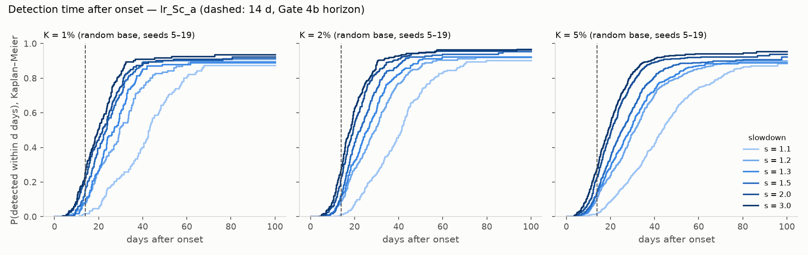
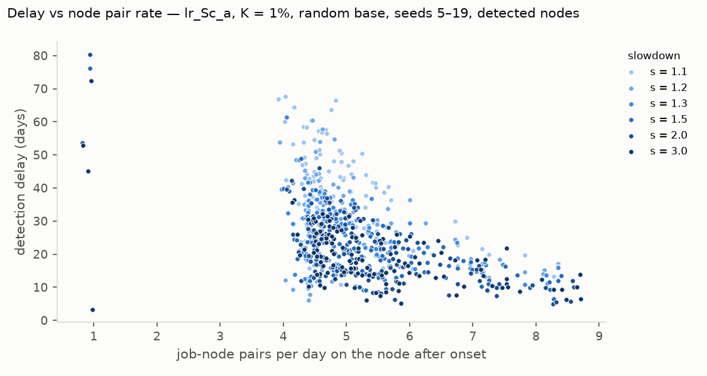
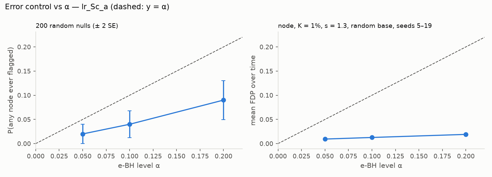
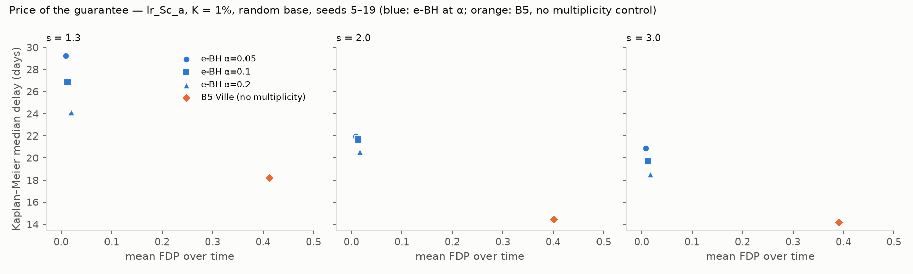

# Phase 4 report — Layer 2: node e-processes and e-BH

_Generated by `scripts/make_phase4_report.py` from run `20261010-094328-full` (commit `436d757a46b6`). Do not edit by hand._

## 1. Result

**Gate 4a (binding, D27): PASS** — chosen configuration `lr_Sc_a` (D65 rule: guard (a) if it passes null + decoy + shock, else none).

**Gate 4b: FAIL** — node, K = 1%, s = 1.3, random base, evaluation seeds 5–19: recall within 14 d (a) 0.100 (target ≥ 0.8); (b) 0.100.
Recall within 14 d (K = 1%, seeds 5–19) reaches 0.5: never for s ≤ 3.0; 0.8: never for s ≤ 3.0. Recall by the trace end reaches 0.5: s = 1.1; 0.8: s = 1.2. Recall (b) equals recall (a) here because every degraded node had at least one affected main-population job.

Numbers below use `lr_Sc_a` unless stated. Development seeds 0–4 (used to choose D60/D61/D66) are reported separately (§8); all gate numbers use seeds 5–19 (D64).

## 2. Method (as run)

- Layer 1 input (D38, D60): centred score S_c, Mode P pooled, W = 7 d, warm-up |R_j| < 30 excluded; recomputed per scenario from the frozen Mode E model (no refit; q̂ reproduces Phase 2 exactly, max |Δ| = 0.0 over 102,120 jobs).
- Bets (D61, D66): per-node jumper (J = 0.01) over {no bet} ∪ shift-LR histogram bets g_s0, s0 ∈ [1.2, 1.3, 1.5, 2.0, 3.0] (g_3.0 added after development seeds, disclosed); each g built once from the warm-up week [freeze, freeze + 7 d]; w_j = 1/|N_j|.
- Selection: e-BH every 6 h at α = 0.1 with m = 980 fixed (D50); evaluations 2020-06-26 15:55:59 → 2020-10-13 03:55:59 (435 times). No reset in simulation (D44).
- Why P(any node ever flagged) ≤ α under the global null (D49): let τ be the first evaluation at which e-BH rejects anything and T the last evaluation. Stopped e-processes M_n(τ ∧ T) are e-values (optional stopping, F16); e-BH on them controls FDR ≤ α under arbitrary dependence (F17); under the global null every rejection is false, so FDR = P(e-BH at τ ∧ T rejects anything) = P(τ ≤ T) ≤ α. Needs fixed m and predictable updates.
- Monte-Carlo SE caveat (D52): the 200 random nulls share ONE real p-value realisation (only placement varies); the SE is conditional on this trace.
- Centring coverage (null trace): level 0 (user + shape) 0.897, level 1 (user) 0.074, level 2 (none) 0.029.

## 3. Gate 4a — validity (random base; P(any node ever flagged) ≤ α + 2 SE, α = 0.1)

| variant | nulls (n=200) | decoy (n=80) | shock (n=80) | heavy decoy (n=80, not binding) | null flags/day | null + decoy + shock |
|---|---|---|---|---|---|---|
| lr_Sc_none | 0.005 ± 0.005 (pass) | 0.000 ± 0.000 (pass) | 0.000 ± 0.000 (pass) | 0.000 ± 0.000 | 0.0002 | pass |
| lr_Sc_a | 0.040 ± 0.014 (pass) | 0.050 ± 0.024 (pass) | 0.050 ± 0.024 (pass) | 0.050 ± 0.024 | 0.0120 | pass |
| lr_Sc_b | 0.000 ± 0.000 (pass) | 0.000 ± 0.000 (pass) | 0.000 ± 0.000 (pass) | 0.000 ± 0.000 | 0.0000 | pass |
| kappa_Sc_none | 0.010 ± 0.007 (pass) | 0.000 ± 0.000 (pass) | 0.000 ± 0.000 (pass) | 0.000 ± 0.000 | 0.0015 | pass |
| plainlr_Sc_none | 0.005 ± 0.005 (pass) | 0.000 ± 0.000 (pass) | 0.000 ± 0.000 (pass) | 0.000 ± 0.000 | 0.0006 | pass |
| lr_Sc_decoyw_none | 0.005 ± 0.005 (pass) | 0.000 ± 0.000 (pass) | 0.000 ± 0.000 (pass) | 0.000 ± 0.000 | 0.0002 | pass |
| lr_S_none | 0.050 ± 0.015 (pass) | 0.100 ± 0.034 (pass) | 0.100 ± 0.034 (pass) | 0.100 ± 0.034 | 0.0212 | pass |
| kappa_S_none | 0.010 ± 0.007 (pass) | 0.000 ± 0.000 (pass) | 0.000 ± 0.000 (pass) | 0.000 ± 0.000 | 0.0036 | pass |
| kappa_none_modeE | 1.000 ± 0.000 (**FAIL**) | 1.000 ± 0.000 (**FAIL**) | 1.000 ± 0.000 (**FAIL**) | 1.000 ± 0.000 | 102.0787 | **FAIL** |
| lr_Sc_none_W24h | 0.030 ± 0.012 (pass) | 0.100 ± 0.034 (pass) | 0.100 ± 0.034 (pass) | 0.100 ± 0.034 | 0.0039 | pass |
| lr_Sc_none_W8760h | 0.040 ± 0.014 (pass) | 0.000 ± 0.000 (pass) | 0.000 ± 0.000 (pass) | 0.000 ± 0.000 | 0.0021 | pass |
| B3_fisher_bh | 1.000 ± 0.000 (**FAIL**) | 1.000 ± 0.000 (**FAIL**) | 1.000 ± 0.000 (**FAIL**) | 1.000 ± 0.000 | 178.5878 | **FAIL** |
| B4_averaged_e | 0.000 ± 0.000 (pass) | 0.000 ± 0.000 (pass) | 0.000 ± 0.000 (pass) | 0.000 ± 0.000 | 0.0000 | pass |
| B5_ville | 1.000 ± 0.000 (**FAIL**) | 1.000 ± 0.000 (**FAIL**) | 1.000 ± 0.000 (**FAIL**) | 1.000 ± 0.000 | 7.2888 | **FAIL** |
| B1_guide | 1.000 ± 0.000 (**FAIL**) | 1.000 ± 0.000 (**FAIL**) | 1.000 ± 0.000 (**FAIL**) | 1.000 ± 0.000 | 47.3346 | **FAIL** |
| B2_top5 | 1.000 ± 0.000 (**FAIL**) | 1.000 ± 0.000 (**FAIL**) | 1.000 ± 0.000 (**FAIL**) | 1.000 ± 0.000 | 49.4537 | **FAIL** |

SE = sqrt(p̂(1 − p̂)/n). Decoy and shock pooled over s ∈ {1.1, 1.2, 1.3, 1.5} (D54). B1, B2, B3, B5 have no FDR guarantee and are shown for context.

Paired check for `lr_Sc_a` (decoy): all 4 flagged scenarios are on base(s) ['rand19'], whose null scenario also flags — the flags come from that placement, not from the injection.

Paired check for `lr_Sc_a` (shock): all 4 flagged scenarios are on base(s) ['rand19'], whose null scenario also flags — the flags come from that placement, not from the injection.

Paired check for `lr_Sc_a` (heavy decoy): all 4 flagged scenarios are on base(s) ['rand19'], whose null scenario also flags — the flags come from that placement, not from the injection.

**Guard (b) — failed design (D65):** it freezes 0.9944 of all job updates on the nulls (mean over 200 nulls), so it passes the null by never updating and has no power. Removed from the guard rule.

**Real base (unknown truth, D39):** real null: ever flagged yes, distinct nodes 9, flags/day 5.3548. user_decoy (n = 80): P(ever) 1.000, mean distinct nodes flagged 8.94 (excess over the real null -0.06). user_decoy_heavy (n = 80): P(ever) 1.000, mean distinct nodes flagged 8.78 (excess over the real null -0.22). 

The unmodified real placement already produces flags (the real null flags 9 nodes); every real-base scenario inherits them, so real-base decoys, shocks and node scenarios are reported with these flags as unknown truth (D39). This is in line with the Phase 2 Step 9 exploratory finding that some PM100 nodes alarm at about twice the overall rate (node-id overlap not checked).

Degenerate shocks (real base, seed 04, no affected job; D47): 4 scenarios, ever flagged: [True, True, True, True] (the real null flags as well).

**Decoys vs decoy size** (affected main-population jobs; random base; `lr_Sc_a`):

| kind | size (jobs) | n | P(ever) | mean distinct nodes flagged |
|---|---|---|---|---|
| user_decoy | (0, 100] | 36 | 0.000 | 0.00 |
| user_decoy | (100, 300] | 32 | 0.125 | 0.12 |
| user_decoy | (300, 1000] | 8 | 0.000 | 0.00 |
| user_decoy | (1000, 3000] | 4 | 0.000 | 0.00 |
| user_decoy_heavy | (100, 300] | 4 | 0.000 | 0.00 |
| user_decoy_heavy | (300, 1000] | 8 | 0.000 | 0.00 |
| user_decoy_heavy | (1000, 3000] | 20 | 0.000 | 0.00 |
| user_decoy_heavy | (3000, 20000] | 48 | 0.083 | 0.08 |

## 4. Gate 4b and detection vs s — `lr_Sc_a`, node, random base, seeds 5–19

**K = 1%**

| s | scen | degraded nodes | recall (a) end | recall (b) end | within 14 d (a) | within 14 d (b) | KM P(≤14 d) | KM median delay (d) | FDP mean | FDP +7 d | FDP +14 d | false co-alloc | false unrelated |
|---|---|---|---|---|---|---|---|---|---|---|---|---|---|
| 1.1 | 15 | 150 | 0.680 | 0.680 | 0.020 | 0.020 | 0.020 | 42.9 | 0.014 | 0.021 | 0.016 | 0.07 | 0.00 |
| 1.2 | 15 | 150 | 0.800 | 0.800 | 0.080 | 0.080 | 0.080 | 29.5 | 0.015 | 0.023 | 0.018 | 0.13 | 0.00 |
| 1.3 | 15 | 150 | 0.807 | 0.807 | 0.100 | 0.100 | 0.100 | 26.9 | 0.013 | 0.021 | 0.015 | 0.20 | 0.00 |
| 1.5 | 15 | 150 | 0.867 | 0.867 | 0.167 | 0.167 | 0.167 | 23.2 | 0.012 | 0.020 | 0.014 | 0.20 | 0.00 |
| 2.0 | 15 | 150 | 0.873 | 0.873 | 0.227 | 0.227 | 0.227 | 21.7 | 0.014 | 0.025 | 0.019 | 0.27 | 0.00 |
| 3.0 | 15 | 150 | 0.893 | 0.893 | 0.273 | 0.273 | 0.273 | 19.7 | 0.012 | 0.022 | 0.012 | 0.20 | 0.00 |

**K = 2%**

| s | scen | degraded nodes | recall (a) end | recall (b) end | within 14 d (a) | within 14 d (b) | KM P(≤14 d) | KM median delay (d) | FDP mean | FDP +7 d | FDP +14 d | false co-alloc | false unrelated |
|---|---|---|---|---|---|---|---|---|---|---|---|---|---|
| 1.1 | 15 | 300 | 0.663 | 0.663 | 0.013 | 0.013 | 0.013 | 41.2 | 0.013 | 0.011 | 0.018 | 0.20 | 0.00 |
| 1.2 | 15 | 300 | 0.787 | 0.787 | 0.093 | 0.093 | 0.093 | 29.2 | 0.010 | 0.008 | 0.013 | 0.27 | 0.00 |
| 1.3 | 15 | 300 | 0.830 | 0.830 | 0.123 | 0.123 | 0.123 | 25.8 | 0.010 | 0.007 | 0.013 | 0.27 | 0.00 |
| 1.5 | 15 | 300 | 0.887 | 0.887 | 0.130 | 0.130 | 0.130 | 22.5 | 0.010 | 0.008 | 0.013 | 0.33 | 0.00 |
| 2.0 | 15 | 300 | 0.920 | 0.920 | 0.237 | 0.237 | 0.237 | 19.2 | 0.009 | 0.008 | 0.013 | 0.33 | 0.00 |
| 3.0 | 15 | 300 | 0.930 | 0.930 | 0.293 | 0.293 | 0.293 | 17.8 | 0.009 | 0.007 | 0.012 | 0.53 | 0.00 |

**K = 5%**

| s | scen | degraded nodes | recall (a) end | recall (b) end | within 14 d (a) | within 14 d (b) | KM P(≤14 d) | KM median delay (d) | FDP mean | FDP +7 d | FDP +14 d | false co-alloc | false unrelated |
|---|---|---|---|---|---|---|---|---|---|---|---|---|---|
| 1.1 | 15 | 735 | 0.599 | 0.599 | 0.020 | 0.020 | 0.020 | 43.4 | 0.006 | 0.006 | 0.007 | 0.20 | 0.00 |
| 1.2 | 15 | 735 | 0.714 | 0.714 | 0.114 | 0.114 | 0.114 | 30.9 | 0.006 | 0.008 | 0.008 | 0.47 | 0.00 |
| 1.3 | 15 | 735 | 0.736 | 0.736 | 0.146 | 0.146 | 0.146 | 28.8 | 0.006 | 0.008 | 0.007 | 0.47 | 0.00 |
| 1.5 | 15 | 735 | 0.781 | 0.781 | 0.150 | 0.150 | 0.150 | 25.0 | 0.006 | 0.007 | 0.006 | 0.53 | 0.00 |
| 2.0 | 15 | 735 | 0.845 | 0.845 | 0.234 | 0.234 | 0.234 | 20.5 | 0.006 | 0.007 | 0.008 | 0.60 | 0.00 |
| 3.0 | 15 | 735 | 0.871 | 0.871 | 0.282 | 0.282 | 0.282 | 18.9 | 0.006 | 0.006 | 0.006 | 0.60 | 0.00 |





node_partial (random base, seeds 5–19, K = 1%):

| s | recall (a) end | within 14 d (a) | KM median (d) | FDP mean |
|---|---|---|---|---|
| 1.1 | 0.687 | 0.020 | 42.5 | 0.014 |
| 1.2 | 0.800 | 0.080 | 29.5 | 0.015 |
| 1.3 | 0.807 | 0.107 | 26.9 | 0.013 |
| 1.5 | 0.867 | 0.167 | 23.2 | 0.012 |

Real base (K = 1%, node, seeds 5–19; flags on non-injected nodes are unknown truth, so FDP here is an upper bound):

| s | recall (a) end | within 14 d (a) | KM median (d) | FDP mean (upper bound) |
|---|---|---|---|---|
| 1.1 | 0.660 | 0.053 | 39.0 | 0.399 |
| 1.2 | 0.773 | 0.180 | 28.2 | 0.333 |
| 1.3 | 0.827 | 0.233 | 25.5 | 0.325 |
| 1.5 | 0.873 | 0.280 | 21.4 | 0.282 |
| 2.0 | 0.887 | 0.333 | 20.2 | 0.227 |
| 3.0 | 0.887 | 0.360 | 20.1 | 0.223 |

## 5. Evidence budget (D67) — `lr_Sc_a`, random base, seeds 5–19

Nats needed = log(980/0.1) + log(6/0.01) = 9.190 + 6.397 = **15.587** (single-node e-BH threshold plus the jumper's worst-case switching cost). Predicted delay = nats / (mean realised log-growth per pair after onset × median pair rate per day).

| K | s | nodes | mean growth/pair | median growth/pair | median pairs/day | predicted delay (d) | observed KM median (d) |
|---|---|---|---|---|---|---|---|
| 1 | 1.1 | 150 | 0.0446 | 0.0509 | 4.79 | 73.0 | 42.9 |
| 1 | 1.2 | 150 | 0.0687 | 0.0759 | 4.81 | 47.2 | 29.5 |
| 1 | 1.3 | 150 | 0.0807 | 0.0883 | 4.85 | 39.8 | 26.9 |
| 1 | 1.5 | 150 | 0.1085 | 0.1169 | 4.89 | 29.4 | 23.2 |
| 1 | 2.0 | 150 | 0.1261 | 0.1330 | 4.97 | 24.9 | 21.7 |
| 1 | 3.0 | 150 | 0.1350 | 0.1421 | 5.07 | 22.8 | 19.7 |
| 2 | 1.1 | 300 | 0.0470 | 0.0488 | 4.89 | 67.9 | 41.2 |
| 2 | 1.2 | 300 | 0.0689 | 0.0726 | 4.90 | 46.2 | 29.2 |
| 2 | 1.3 | 300 | 0.0793 | 0.0820 | 4.92 | 40.0 | 25.8 |
| 2 | 1.5 | 300 | 0.1003 | 0.1031 | 4.95 | 31.4 | 22.5 |
| 2 | 2.0 | 300 | 0.1165 | 0.1190 | 5.00 | 26.8 | 19.2 |
| 2 | 3.0 | 300 | 0.1342 | 0.1400 | 5.10 | 22.7 | 17.8 |
| 5 | 1.1 | 735 | 0.0357 | 0.0378 | 4.81 | 90.9 | 43.4 |
| 5 | 1.2 | 735 | 0.0528 | 0.0550 | 4.84 | 61.0 | 30.9 |
| 5 | 1.3 | 735 | 0.0596 | 0.0623 | 4.87 | 53.7 | 28.8 |
| 5 | 1.5 | 735 | 0.0707 | 0.0746 | 4.91 | 44.9 | 25.0 |
| 5 | 2.0 | 735 | 0.0879 | 0.0922 | 4.98 | 35.6 | 20.5 |
| 5 | 3.0 | 735 | 0.1048 | 0.1134 | 5.05 | 29.4 | 18.9 |

The e-BH threshold for a single flag is log(m/α); several degraded nodes can be flagged together at a lower individual threshold, so observed delays can be shorter than predicted.

D62 detectability floor (null trace, optimistic: only the scored job is shifted, centring cancellation and jumper switching cost ignored; bet grid now includes g_3.0):

| score | s | κ days | LR jumper days | oracle days |
|---|---|---|---|---|
| S | 1.1 | — | — | 356.2 |
| S | 1.2 | 843.5 | — | 171.8 |
| S | 1.3 | 159.7 | 573.2 | 106.7 |
| S | 1.5 | 57.9 | 117.1 | 60.9 |
| S | 2.0 | 23.7 | 50.7 | 32.2 |
| S | 3.0 | 8.6 | 19.2 | 16.5 |
| Sc | 1.1 | — | 34.8 | 27.3 |
| Sc | 1.2 | 195.7 | 22.2 | 18.2 |
| Sc | 1.3 | 97.9 | 21.6 | 15.8 |
| Sc | 1.5 | 53.2 | 15.4 | 12.4 |
| Sc | 2.0 | 28.9 | 11.7 | 9.5 |
| Sc | 3.0 | 17.4 | 10.1 | 6.2 |

## 6. Error control vs α and the price of the guarantee (D69)



| α | null P(ever) ± SE (200) | node FDP mean (K 1%, s 1.3) |
|---|---|---|
| 0.05 | 0.020 ± 0.010 | 0.009 |
| 0.1 | 0.040 ± 0.014 | 0.013 |
| 0.2 | 0.090 ± 0.020 | 0.019 |



| s | method | FDP mean | KM median delay (d) | recall at trace end |
|---|---|---|---|---|
| 1.3 | e-BH α=0.05 | 0.009 | 29.2 | 0.800 |
| 1.3 | e-BH α=0.1 | 0.013 | 26.9 | 0.807 |
| 1.3 | e-BH α=0.2 | 0.019 | 24.2 | 0.820 |
| 1.3 | B5 Ville (no multiplicity) | 0.413 | 18.2 | 0.913 |
| 2.0 | e-BH α=0.05 | 0.009 | 22.0 | 0.867 |
| 2.0 | e-BH α=0.1 | 0.014 | 21.7 | 0.873 |
| 2.0 | e-BH α=0.2 | 0.016 | 20.6 | 0.873 |
| 2.0 | B5 Ville (no multiplicity) | 0.401 | 14.5 | 0.940 |
| 3.0 | e-BH α=0.05 | 0.008 | 20.9 | 0.887 |
| 3.0 | e-BH α=0.1 | 0.012 | 19.7 | 0.893 |
| 3.0 | e-BH α=0.2 | 0.017 | 18.6 | 0.900 |
| 3.0 | B5 Ville (no multiplicity) | 0.391 | 14.2 | 0.940 |

## 7. Ablations and baselines (Gate 4a set + Gate 4b slice; random base; seeds 5–19 for node rows)

| variant | null P(ever) | decoy P(ever) | shock P(ever) | s=1.3: within 14 d / end / FDP | s=2.0: within 14 d / end / FDP | s=3.0: within 14 d / end / FDP |
|---|---|---|---|---|---|---|
| lr_Sc_none | 0.005 | 0.000 | 0.000 | 0.087 / 0.800 / 0.000 | 0.153 / 0.873 / 0.000 | 0.173 / 0.873 / 0.000 |
| lr_Sc_a | 0.040 | 0.050 | 0.050 | 0.100 / 0.807 / 0.013 | 0.227 / 0.873 / 0.014 | 0.273 / 0.893 / 0.012 |
| lr_Sc_b | 0.000 | 0.000 | 0.000 | 0.000 / 0.000 / 0.000 | 0.000 / 0.000 / 0.000 | 0.000 / 0.000 / 0.000 |
| kappa_Sc_none | 0.010 | 0.000 | 0.000 | 0.000 / 0.013 / 0.000 | 0.000 / 0.367 / 0.000 | 0.007 / 0.707 / 0.000 |
| plainlr_Sc_none | 0.005 | 0.000 | 0.000 | 0.007 / 0.280 / 0.000 | 0.007 / 0.427 / 0.000 | 0.013 / 0.500 / 0.000 |
| lr_Sc_decoyw_none | 0.005 | 0.000 | 0.000 | 0.093 / 0.793 / 0.000 | 0.140 / 0.873 / 0.000 | 0.173 / 0.873 / 0.000 |
| lr_S_none | 0.050 | 0.100 | 0.100 | 0.000 / 0.000 / 0.050 | 0.000 / 0.053 / 0.049 | 0.007 / 0.420 / 0.052 |
| kappa_S_none | 0.010 | 0.000 | 0.000 | 0.000 / 0.000 / 0.000 | 0.000 / 0.100 / 0.000 | 0.013 / 0.547 / 0.000 |
| kappa_none_modeE | 1.000 | 1.000 | 1.000 | 0.280 / 0.767 / 0.684 | 0.500 / 0.873 / 0.664 | 0.633 / 0.880 / 0.655 |
| lr_Sc_none_W24h | 0.030 | 0.100 | 0.100 | 0.013 / 0.620 / 0.009 | 0.087 / 0.827 / 0.008 | 0.253 / 0.873 / 0.008 |
| lr_Sc_none_W8760h | 0.040 | 0.000 | 0.000 | 0.193 / 0.867 / 0.000 | 0.213 / 0.880 / 0.001 | 0.173 / 0.847 / 0.001 |
| B3_fisher_bh | 1.000 | 1.000 | 1.000 | 0.333 / 0.680 / 0.538 | 0.560 / 0.913 / 0.637 | 0.660 / 0.947 / 0.692 |
| B4_averaged_e | 0.000 | 0.000 | 0.000 | 0.000 / 0.000 / 0.000 | 0.000 / 0.000 / 0.000 | 0.000 / 0.000 / 0.000 |
| B5_ville | 1.000 | 1.000 | 1.000 | 0.393 / 0.913 / 0.413 | 0.493 / 0.940 / 0.401 | 0.493 / 0.940 / 0.391 |
| B1_guide | 1.000 | 1.000 | 1.000 | 0.200 / 0.873 / 0.484 | 0.373 / 0.887 / 0.496 | 0.413 / 0.893 / 0.489 |
| B2_top5 | 1.000 | 1.000 | 1.000 | 0.167 / 0.527 / 0.994 | 0.227 / 0.567 / 0.993 | 0.287 / 0.613 / 0.991 |

Variants: `lr_Sc_none` primary without guard; `lr_Sc_a` guard (a) detrend; `lr_Sc_b` guard (b) (failed design, D65); `kappa_Sc_none` κ power-calibrator mixture instead of LR bets; `plainlr_Sc_none` plain product of LR bets (no jumper); `lr_Sc_decoyw_none` decoy-defence weight (D40); `lr_S_none` / `kappa_S_none` raw S (no centring; `kappa_S_none` = first-pilot primary); `kappa_none_modeE` Mode E as-run p-values (B6); `lr_Sc_none_W24h` / `_W8760h` Mode P window 1 d / 365 d (B6); B1 guide heuristic (7-d windows, daily, D55), B2 top 5%, B3 Fisher + BH, B4 averaged e-values + e-BH, B5 per-node Ville (no multiplicity control).

## 8. Development seeds 0–4 (used to choose D60/D61/D66) — `lr_Sc_a`, node, K = 1%, random base

| s | recall (a) end | within 14 d (a) | KM median (d) | FDP mean |
|---|---|---|---|---|
| 1.1 | 0.640 | 0.040 | 47.7 | 0.000 |
| 1.2 | 0.760 | 0.120 | 32.4 | 0.000 |
| 1.3 | 0.840 | 0.160 | 28.4 | 0.000 |
| 1.5 | 0.880 | 0.180 | 21.5 | 0.000 |
| 2.0 | 0.900 | 0.260 | 19.5 | 0.000 |
| 3.0 | 0.880 | 0.320 | 17.2 | 0.000 |

## 9. D59 paired check (affected job vs the same job in the matching null; development seeds)

| s | score | mean of per-scenario median Δp | mean share negative |
|---|---|---|---|
| 1.3 | S | -0.0323 | 0.894 |
| 1.3 | Sc | -0.0657 | 0.878 |
| 1.5 | S | -0.0488 | 0.891 |
| 1.5 | Sc | -0.0965 | 0.873 |
| 2.0 | S | -0.0767 | 0.887 |
| 2.0 | Sc | -0.1550 | 0.862 |

Largest per-scenario median Δp: -0.0302 (negative in every scenario): injection lowers the job's p-value. The higher median p after onset seen in the first pilot is a time trend that is present in the null too: measured interactively during the first pilot (not a stored run), the median over the 50 degraded nodes of [null p after onset − null p before onset] was +0.081 (84% of nodes), larger than the paired injection effect at s = 1.3.

## 10. Runs and commands

```bash
uv run python -m hpcdiag.layer2.run_layer2 --config configs/phase4_layer2.yaml --mode full --workers 7   # 20261010-094328-full
uv run python scripts/make_phase4_report.py --run 20261010-094328-full --pilots 20261010-085943-pilot 20261010-092242-pilot2
```

- Pilot runs (development, seeds 0–4): `20261010-085943-pilot`, `20261010-092242-pilot2`.
- Full grid: 1881 scenarios, 7 workers, wall 59.3 min.
- Tests: `176 passed in 15.12s`; lint: `All checks passed!`.

Phase 4 complete. Stopped; Phase 5 not started.
